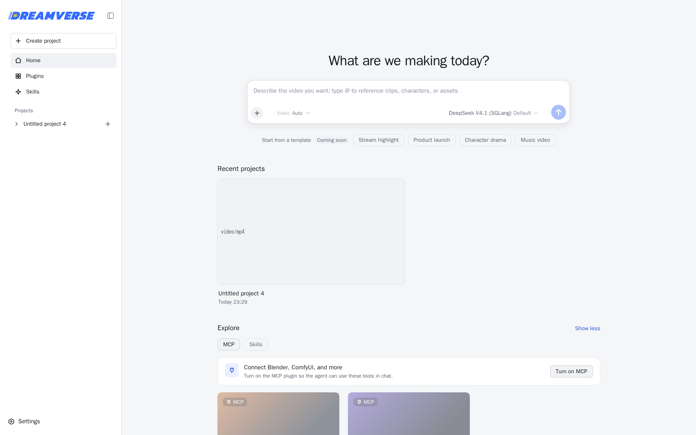
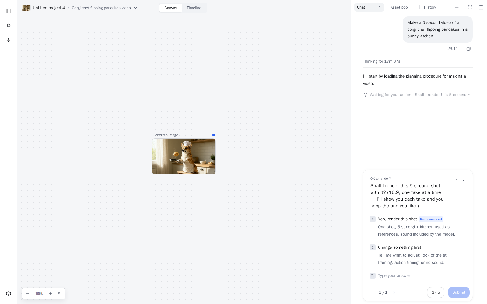

# DreamVerse Harness

English | [中文](README.zh.md)

<p align="center"></p>

<p align="center"><strong>Open-source AI filmmaking on your own models.</strong></p>

<p align="center"><a href="#features">Features</a> · <a href="#get-started">Get started</a> · <a href="#how-it-works">How it works</a> · <a href="#community">Community</a></p>

DreamVerse Harness takes local video generation from single clips to complete films. You describe a film in a chat, and an agent works with you to write it, design its characters and places, render every shot, and cut the takes together on a timeline. It runs on your own GPUs through [FastVideo](https://github.com/hao-ai-lab/FastVideo), it works with any model you connect, and every part of it is a plugin you can change.

<picture>
  <source media="(prefers-color-scheme: dark)" srcset="docs/user/guide/dreamverse-workspace-dark.png">
  
</picture>

## Features

- **Runs on your hardware.** DreamVerse Harness renders through a FastVideo server running FastH3. Put that server on a GPU cluster, or run it locally on an RTX GPU, a DGX Spark, or Apple Silicon. You pay for electricity, not for credits.
- **Bring any model.** Each video, image, or audio model is one provider plugin in the model catalog. To add your own model or API, write a provider plugin, or ask a coding agent to write it with the built-in [`dv-add-model-provider`](.agents/skills/dv-add-model-provider/SKILL.md) skill.
- **An agent that knows how to direct.** The agent follows directing skills and model-specific prompting skills, and it acts through a dedicated toolset: it breaks down the story, locks character and location references, renders shots, and lays out the timeline.
- **Direct it interactively.** FastH3 renders a take in seconds, so you can watch a shot and steer the next one right away. The agent asks before it spends GPU time, and you can re-roll one shot, swap a reference, or recut the sequence without starting over.
- **Bring your own skills.** Skills are Markdown files that teach the agent how to work. Edit the shipped ones or drop your own into [`packages/bundle/dv/skills/`](packages/bundle/dv/skills), then start any of them from the Skills page. Turn whole features on and off on the Plugins page.
- **One history for you and the agent.** Every change, from the chat or from the canvas, is a step in the project history. Undo and redo work the same for both, and an undone take stays available for comparison.

<table>
  <tr>
    <td width="50%"><br><sub>Start from one sentence on the Home page.</sub></td>
    <td width="50%"><br><sub>The agent asks before it renders.</sub></td>
  </tr>
  <tr>
    <td width="50%"><br><sub>Every step is in the History panel.</sub></td>
    <td width="50%"><br><sub>Edit and export on the timeline.</sub></td>
  </tr>
</table>

DreamVerse Harness is a research preview. Expect breaking changes, and read the [safety notice](SAFETY.md) before you run it.

<a id="run"></a>

## Get started

DreamVerse Harness needs two servers: a FastVideo server that renders the video, and an OpenAI-compatible chat endpoint that runs the agent.

### What you need

- Node.js `^22.19.0` or `>=24.0.0`, and pnpm `11.7.0`.
- `ffmpeg` and `ffprobe`.
- GPUs for the FastVideo server. The FastH3 8-Step configuration below uses 4 NVIDIA GPUs.
- An OpenAI-compatible chat endpoint for the agent, such as an SGLang server with DeepSeek V4.1, and its API key if it needs one.

### 1. Start a video server

On the GPU machine, install FastVideo and serve FastH3 8-Step V2 (text to video with audio) on port 8000:

```sh
uv venv --python 3.12 --seed && source .venv/bin/activate
git clone https://github.com/hao-ai-lab/FastVideo.git && cd FastVideo
UV_TORCH_BACKEND=cu130 uv pip install -e ".[fasth3]"
fastvideo serve --config examples/serving/openai_fasth3_8step.yaml --server.host 127.0.0.1
```

To run the server on one local machine, use the matching configuration in [FastVideo's serving examples](https://github.com/hao-ai-lab/FastVideo/tree/main/examples/serving): `openai_fasth3_omniref_rtx5090.yaml`, `openai_fasth3_omniref_rtx_pro6000.yaml`, or `openai_fasth3_omniref_spark.yaml` for FastH3 OmniRef on one GPU, or `mlx_fasth3_8step.yaml` on Apple Silicon.

<a id="run-from-source"></a>

### 2. Install DreamVerse Harness

The repository is private for now; cloning it needs a GitHub account with access to `fastvideo-project/dreamverse-harness`.

```sh
git clone https://github.com/fastvideo-project/dreamverse-harness
cd dreamverse-harness
pnpm install
pnpm run build
```

### 3. Connect the video server

Create the `video-harness` profile:

```sh
export DSH_HOME="$HOME/.local/state/dsh-video-harness"
scripts/video-harness/setup-profile.sh
```

Then point the profile at your FastVideo server. This patch turns on the `fastvideo` provider with your server for task `t2v`, and turns off the providers that point at the development cluster:

```sh
cat > "$DSH_HOME/profiles/video-harness/cordis.patch.yml" <<'EOF'
- id: dv-fastvideo
  disabled: false
  config:
    models:
      fasth3:
        t2v:
          baseUrl: http://127.0.0.1:8000
          modelFacts:
            modelId: fasth3
            frameSizes: { '16:9': { 768p: [1344, 768] }, '9:16': { 768p: [768, 1344] }, '1:1': { 768p: [768, 768] } }
            numFramesByDurationSec: { 5: 124, 6: 158, 7: 175, 8: 192, 9: 226, 10: 243, 11: 277, 12: 294, 13: 328, 14: 345, 15: 362 }
            maxReferences: 0
            referenceMediaTypes: {}
- id: dv-uniserve
  disabled: true
- id: dv-sglang-diffusion
  disabled: true
- id: dv-sglang-omni
  disabled: true
EOF
```

For a FastH3 OmniRef server, put it under `ref2v` with the `ref2v` model facts of the `dv-fastvideo` row in [`packages/bundle/dv/cordis.patch.yml`](packages/bundle/dv/cordis.patch.yml). A `ref2v` model needs at least one reference image for each shot; attach a photo in the chat, or keep an image model on so that the agent can make one. The [`@dv/fastvideo` README](packages/dv/fastvideo/README.md) describes every field.

### 4. Connect the agent model

Set the agent's endpoint and key, the media tools, and the folder for your projects:

```sh
export DV_DEEPSEEK_BASE_URL=http://<your endpoint>/v1
export DV_DEEPSEEK_API_KEY=<your key>
export DV_FFMPEG="$(command -v ffmpeg)"
export DV_PROJECTS_FOLDER="$HOME/DreamVerse"
mkdir -p "$DV_PROJECTS_FOLDER"
```

Leave `DV_DEEPSEEK_API_KEY` unset for a server without a key. Set `DV_AGENT_VISION=0` if the model cannot read images. The [`@dv/bundle` README](packages/bundle/dv/README.md) lists the other variables, such as `DV_AGENT_MODEL` and `DV_PORT`.

### 5. Launch

```sh
scripts/video-harness/launch.sh web
```

The web interface listens on port `8092`. Open the URL that the command prints, such as `http://127.0.0.1:8092/?token=…`; the token logs you in. To open the page from another machine, add `--trusted-host <host name>` to the command.

### 6. Make your first video

1. On the Home page, type what you want in the prompt box, for example `Make a 5-second video of a corgi chef flipping pancakes in a sunny kitchen.`, and press Enter. DreamVerse creates a project and opens it.
2. When the agent asks a question, choose an answer and click **Submit**.
3. Before it renders, the agent asks **OK to render?**. Choose **Yes, render this shot**.
4. The take appears on the **Canvas**, and the agent places it on the **Timeline**. The **History** panel lists every step, and you can undo any of them.
5. Open the **Timeline** tab and click **Export** to save the video file.

## How it works

DreamVerse Harness is built on [DeepSeek Harness](https://github.com/deepseek-ai/deepseek-harness), an agent harness in which every capability is a [Cordis](https://github.com/cordiverse/cordis) plugin. DreamVerse adds video production as plugins in layers: a project layer that records every change in an append-only history, a model catalog with one provider plugin per model, features such as characters, locations, shot renders and the timeline, and workflows such as the story workflow that combine them. Each plugin ships the skills that tell the agent how to use it.

The [DreamVerse packages page](docs/subsystems/video-harness.md) describes the layers, the operation record, and the history rules.

## Community

- Join the [FastVideo Slack](https://join.slack.com/t/fastvideo/shared_invite/zt-4heayzk81-lOkgpvJRoceuZjNP7pXxJA) to ask questions and share what you make.
- Join the [Discord server](https://discord.gg/dqc2J2yNQ) to chat with other users.
- Report bugs and request features in [GitHub Issues](https://github.com/fastvideo-project/dreamverse-harness/issues).
- Share your provider plugins and skills: open a pull request, or post them in Slack or Discord.

## Development

Start with the [development guide](docs/development.md) and the [architecture documentation](docs/architecture.md). See [CONTRIBUTING.md](CONTRIBUTING.md) for contribution rules. For agents, follow [AGENTS.md](AGENTS.md).

## License

[MIT](LICENSE). DreamVerse Harness is built on DeepSeek Harness, which DeepSeek publishes under the MIT license.

Third-party dependencies and their licenses are disclosed in [THIRD_PARTY_NOTICES.md](THIRD_PARTY_NOTICES.md).
