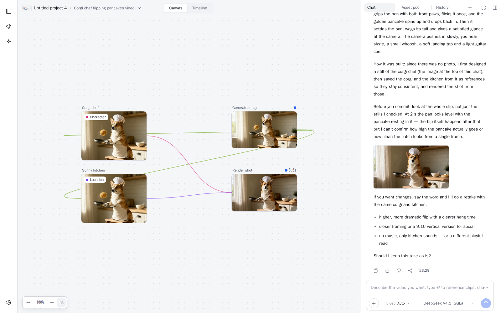
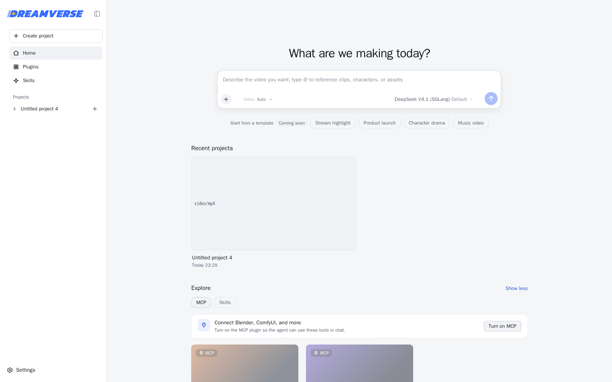
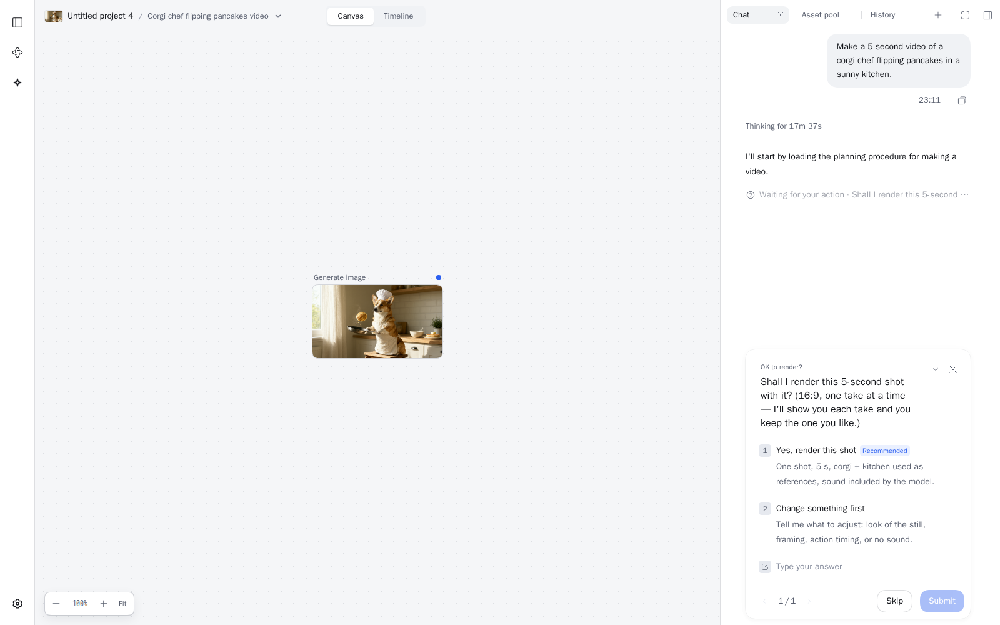
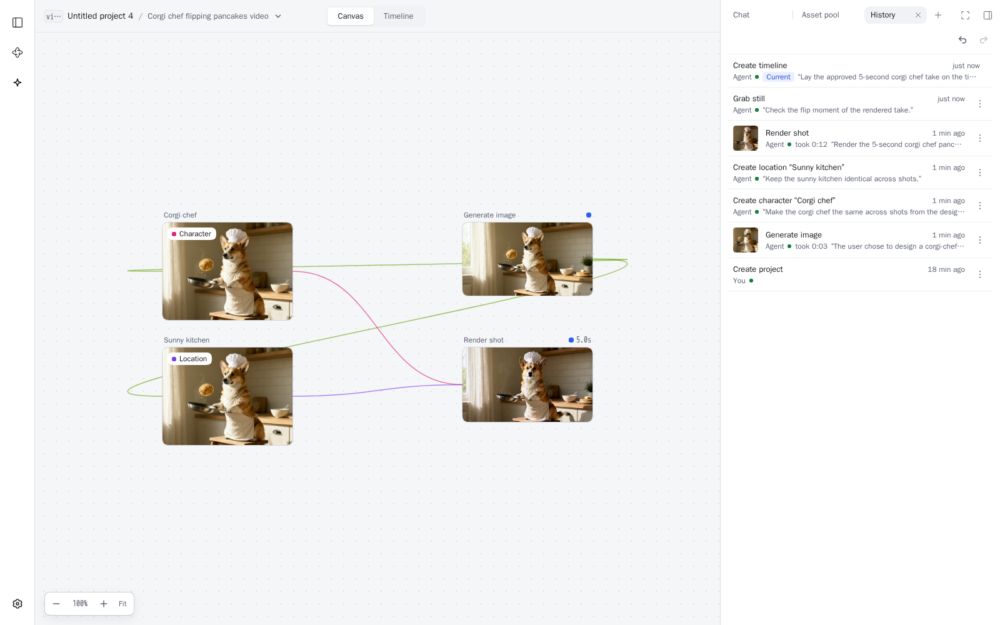
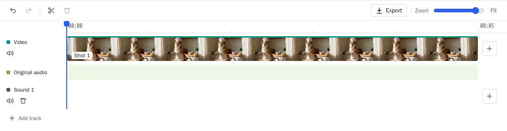

# DreamVerse Harness

[English](README.md) | 中文

<p align="center"></p>

<p align="center"><strong>用你自己的 GPU，做开源 AI 电影。</strong></p>

<p align="center"><a href="#features">功能</a> · <a href="#get-started">快速开始</a> · <a href="#how-it-works">工作原理</a> · <a href="#community">社区</a></p>

DreamVerse Harness 把本地视频生成从单个片段推进到完整的影片。你在对话里描述一部片子，agent（智能体）和你一起写故事、设计角色和场景、渲染每个镜头，再把各条 take 剪进时间线。它通过 [FastVideo](https://github.com/hao-ai-lab/FastVideo) 运行在你自己的 GPU 上，可以接入任何模型，而且每一部分都是可以替换的插件。

<picture>
  <source media="(prefers-color-scheme: dark)" srcset="docs/user/guide/dreamverse-workspace-dark.png">
  
</picture>

<a id="features"></a>

## 功能

- **跑在你自己的硬件上。** DreamVerse Harness 通过运行 FastH3 的 FastVideo 服务器渲染。这台服务器可以放在 GPU 集群上，也可以在本地的 RTX GPU、DGX Spark 或 Apple Silicon 上运行。你付的是电费，而不是点数。
- **接入任何模型。** 每个视频、图像或音频模型都是模型目录里的一个提供方插件。要接入你自己的模型或 API，写一个提供方插件，或者让编程 agent 用内置的 [`dv-add-model-provider`](.agents/skills/dv-add-model-provider/SKILL.md) skill（技能）来写。
- **懂导演的 agent。** agent 遵循导演 skill 和各模型专属的提示词 skill，并通过一套专用工具行动：拆解故事、锁定角色与场景参考、渲染镜头、排好时间线。
- **交互式导演。** FastH3 几秒钟就能渲染出一条 take，你可以看完一个镜头马上调整下一个。agent 在占用 GPU 之前会先问你；你可以重抽一个镜头、换一张参考图，或者重新剪辑整段，而不必从头再来。
- **带上你自己的 skill。** skill 是教 agent 如何工作的 Markdown 文件。修改自带的 skill，或者把你自己的放进 [`packages/bundle/dv/skills/`](packages/bundle/dv/skills)，然后在技能页启动任意一个。在插件页可以整块开关功能。
- **你和 agent 共用一份历史。** 每次修改，无论来自对话还是画布，都是项目历史中的一步。撤销和重做对双方一视同仁，被撤销的 take 仍然保留，方便对比。

<table>
  <tr>
    <td width="50%"><br><sub>在首页用一句话开始。</sub></td>
    <td width="50%"><br><sub>agent 在渲染前先询问你。</sub></td>
  </tr>
  <tr>
    <td width="50%"><br><sub>每一步都在历史面板里。</sub></td>
    <td width="50%"><br><sub>在时间线上剪辑并导出。</sub></td>
  </tr>
</table>

DreamVerse Harness 是研究预览版。会有不兼容的变更；运行前请阅读[安全须知](SAFETY.zh.md)。

<a id="run"></a><a id="get-started"></a>

## 快速开始

DreamVerse Harness 需要两个服务器：一个渲染视频的 FastVideo 服务器，以及一个运行 agent 的 OpenAI 兼容对话端点。

### 准备条件

- Node.js `^22.19.0` 或 `>=24.0.0`，以及 pnpm `11.7.0`。
- `ffmpeg` 和 `ffprobe`。
- 运行 FastVideo 服务器的 GPU。下面的 FastH3 8-Step 配置使用 4 块 NVIDIA GPU，也可以在 2 块显存大于 80 GB 的 GPU 上运行，例如 NVIDIA GB200（见第 1 步）。
- 一个供 agent 使用的 OpenAI 兼容对话端点，例如运行 DeepSeek V4.1 的 SGLang 服务器；如果端点需要，还要准备它的 API key。

### 1. 启动视频服务器

在 GPU 机器上安装 FastVideo，并在 8000 端口提供 FastH3 8-Step V2（文生带音频视频）：

```sh
uv venv --python 3.12 --seed && source .venv/bin/activate
git clone https://github.com/hao-ai-lab/FastVideo.git && cd FastVideo
UV_TORCH_BACKEND=cu130 uv pip install -e ".[fasth3]"
fastvideo serve --config examples/serving/openai_fasth3_8step.yaml --server.host 127.0.0.1
```

安装大约需要 10 分钟，第一次启动还会下载模型权重。服务器会一直在这个终端里运行，所以后面的步骤请在另一个终端里做。服务器打印 `Uvicorn running on http://127.0.0.1:8000` 时就绪；这时 `curl http://127.0.0.1:8000/v1/models` 会列出 `fasth3`。

如果 GPU 少于 4 块，把 GPU 数和序列并行大小设成同一个数。这个数必须能整除模型的 56 个注意力头，所以 3 块 GPU 会在启动时失败。在 2 块 GPU 上，每块 GPU 需要大于 80 GB 的显存。例如：

```sh
CUDA_VISIBLE_DEVICES=0,1 fastvideo serve --config examples/serving/openai_fasth3_8step.yaml --server.host 127.0.0.1 \
  --generator.engine.num_gpus 2 --generator.engine.parallelism.sp_size 2
```

如果服务器打印 `Application startup failed. Exiting.`，`fastvideo serve` 进程可能仍在运行。再次启动服务器之前，先停掉这个进程。

要在一台本地机器上运行服务器，使用 [FastVideo 服务示例](https://github.com/hao-ai-lab/FastVideo/tree/main/examples/serving)中对应的配置：单块 GPU 上的 FastH3 OmniRef 用 `openai_fasth3_omniref_rtx5090.yaml`、`openai_fasth3_omniref_rtx_pro6000.yaml` 或 `openai_fasth3_omniref_spark.yaml`，Apple Silicon 上用 `mlx_fasth3_8step.yaml`。

<a id="run-from-source"></a>

### 2. 安装 DreamVerse Harness

```sh
git clone https://github.com/fastvideo-project/dreamverse-harness
cd dreamverse-harness
pnpm install
pnpm run build
```

`pnpm install` 和 `pnpm run build` 加起来大约需要 10 分钟。`pnpm install` 期间出现的 `dsh` 的 `Failed to create bin` 警告在第一次构建之前是正常的。

### 3. 连接视频服务器

创建 `video-harness` profile：

```sh
export DSH_HOME="$HOME/.local/state/dsh-video-harness"
scripts/video-harness/setup-profile.sh
```

脚本成功时不打印任何内容。

然后把 profile 指向你的 FastVideo 服务器。这个 patch 为生成任务 `t2v` 打开 `fastvideo` 提供方并填入你的服务器，同时关闭指向开发集群的提供方：

```sh
cat > "$DSH_HOME/profiles/video-harness/cordis.patch.yml" <<'EOF'
- id: dv-fastvideo
  disabled: false
  config:
    models:
      fasth3:
        t2v:
          baseUrl: http://127.0.0.1:8000
          modelFacts:
            modelId: fasth3
            frameSizes: { '16:9': { 768p: [1344, 768] }, '9:16': { 768p: [768, 1344] }, '1:1': { 768p: [768, 768] } }
            numFramesByDurationSec: { 5: 124, 6: 158, 7: 175, 8: 192, 9: 226, 10: 243, 11: 277, 12: 294, 13: 328, 14: 345, 15: 362 }
            maxReferences: 0
            referenceMediaTypes: {}
- id: dv-uniserve
  disabled: true
- id: dv-sglang-diffusion
  disabled: true
- id: dv-sglang-omni
  disabled: true
EOF
```

如果是 FastH3 OmniRef 服务器，把它放在 `ref2v` 下，并使用 [`packages/bundle/dv/cordis.patch.yml`](packages/bundle/dv/cordis.patch.yml) 中 `dv-fastvideo` 行的 `ref2v` 模型参数。`ref2v` 模型的每个镜头至少需要一张参考图；可以在对话里附上一张照片，或者保持图像模型开启，让 agent 自己生成一张。[`@dv/fastvideo` README](packages/dv/fastvideo/README.zh.md) 说明了每个字段。

### 4. 连接 agent 模型

设置 agent 的端点和 key、启动脚本的环境文件、媒体工具，以及存放项目的文件夹：

```sh
export DV_DEEPSEEK_BASE_URL=http://<your endpoint>/v1
export DV_DEEPSEEK_API_KEY=<your key>   # omit this line for a server without a key
export DV_ENV_FILE=/dev/null
export DV_FFMPEG="$(command -v ffmpeg)"
export DV_PROJECTS_FOLDER="$HOME/DreamVerse"
mkdir -p "$DV_PROJECTS_FOLDER"
```

agent 使用模型 `deepseek-v4.1`。如果 `$DV_DEEPSEEK_BASE_URL/models` 列出的是别的名字，把 `DV_AGENT_MODEL` 设成那个名字。如果模型不能读图，设置 `DV_AGENT_VISION=0`。[`@dv/bundle` README](packages/bundle/dv/README.zh.md) 列出了其他变量，例如 `DV_PORT`。

### 5. 启动

```sh
scripts/video-harness/launch.sh web
```

请在第 4 步的同一个 shell 里运行这条命令，因为 `launch.sh` 读取第 4 步设置的变量。没有 `DV_DEEPSEEK_BASE_URL` 时，`launch.sh` 会使用开发集群上的服务器。`launch.sh` 还会加载 `DV_ENV_FILE` 指定的文件，默认值是开发机器上的一个文件；第 4 步把 `DV_ENV_FILE` 设成了 `/dev/null`。要从文件加载提供方 key（例如 `GROQ_API_KEY`），把 `DV_ENV_FILE` 设成那个文件。

Web 界面监听 `8092` 端口。打开命令打印的 URL，例如 `http://127.0.0.1:8092/?token=…`；其中的 token 用于登录。要从另一台机器打开页面，在命令后加上 `--trusted-host <host name>`。

### 6. 做出你的第一个视频

1. 在首页的提示词输入框里写下你想要的内容，例如 `Make a 5-second video of a corgi chef flipping pancakes in a sunny kitchen.`，然后按 Enter。DreamVerse 会创建一个项目并打开它。
2. agent 提问时，选择一个答案并点击 **Submit**。
3. 渲染之前，agent 会请你确认这个镜头，例如 **Shall I render this one 5-second shot, and in which framing?**。问题和选项在每次对话中都不一样。选择一个 **Yes** 开头的答案，例如 **Yes — 16:9 widescreen**，然后点击 **Submit**。在 2 块 NVIDIA GB200 GPU 上，一个 5 秒的镜头大约需要 3 分钟。
4. take 出现在 **Canvas** 上。**History** 面板列出每一步，任何一步都可以撤销。
5. 打开 **Timeline** 标签页。如果它显示 **The project has no timelines yet**，说明 agent 没有把 take 放到时间线上。在对话里告诉 agent：`Put the shot on the timeline.`
6. 点击 **Export**。导出完成后，点击 **Open the exported video**。视频会在新的浏览器标签页中打开。用 `.mp4` 文件名保存它，因为链接没有文件扩展名。

<a id="set-up-on-dgx-spark"></a>

### 在 DGX Spark 上设置

要在一到四台 NVIDIA DGX Spark 上设置 DreamVerse Harness、FastVideo 和本地 LLM，可以交给编程 agent 来做。在 Codex 或 Claude Code 中安装 [`dreamverse-dgx-spark-setup`](.agents/skills/dreamverse-dgx-spark-setup/SKILL.md) skill，然后让 agent 在你的 DGX Spark 上设置 DreamVerse：

```sh
npx skills add fastvideo-project/dreamverse-harness --skill dreamverse-dgx-spark-setup
```

agent 会检查每台 DGX Spark，按你的硬件选择模型布局，安装 FastVideo、LLM 和 DreamVerse Harness，并用一次测试渲染检查每台机器。如果想自己动手，按照 [DGX Spark 指南](scripts/video-harness/dgx-spark.md)操作，它给出了完整的命令，并在每一步之后附有检查。指南包含以下方案：

**[一台 DGX Spark，完全本地](scripts/video-harness/dgx-spark.md#1-fully-local-on-one-dgx-spark)。** Qwen 3.8 27B（在 vLLM 下约 39 GB）和 FastH3 Trim（渲染时约 45 GB）共用一台机器：

1. 准备机器：带 CUDA 13 的 DGX OS、至少 120 GB 的可用磁盘空间、Hugging Face 登录（`hf auth login`），以及一个内存看门狗，因为内存不足可能让 GB10 卡死。
2. 下载权重：

   ```sh
   hf download nvidia/Qwen3.8-27B-NVFP4 --local-dir ~/models/Qwen3.8-27B-NVFP4
   hf download FastVideo/FastVideo-FastH3-Trim-8-Step-NVFP4 --local-dir ~/models/FastH3-Trim-8-Step-NVFP4
   ```

3. 用 vLLM 的 nightly CUDA 13 wheel 在 8000 端口提供 Qwen，并设置 `--gpu-memory-utilization 0.32`，让 FastH3 能放在它旁边。先启动它，因为它第一次启动时会编译 kernel。
4. 按照 FastVideo 的 [DGX Spark 指南](https://github.com/hao-ai-lab/FastVideo/blob/main/docs/getting_started/installation/spark_performance.md)安装 FastVideo，并用本地权重在 18000 端口以 `examples/serving/openai_fasth3_trim_spark.yaml` 提供 FastH3 Trim。
5. 构建 DreamVerse Harness，创建它的 profile，并写一个 profile patch，让 agent 指向 Qwen，让 `dv-fastvideo` 指向 FastH3 Trim。然后用 `scripts/video-harness/launch.sh web` 启动 Web 界面，并在 DGX Spark 的浏览器中打开打印出的 URL。

**[多台 DGX Spark](scripts/video-harness/dgx-spark.md#2-several-dgx-sparks)。** 每台 DGX Spark 运行自己的 FastVideo 服务器，绑定到它在直连线缆或局域网上的地址，并带有一个模型目录（`server.model_catalog`），让 agent 可以在上面加载和卸载模型。在 profile patch 中，为每个模型填上其服务器的 `baseUrl`，并在每个带模型目录的服务器上设置 `managed: true`。一个 FastH3 NVFP4 模型占用 40 到 55 GB，所以一台 DGX Spark 能放两个，或者在 Qwen 旁边放一个。

**[两台 DGX Spark 上的 2K](scripts/video-harness/dgx-spark.md#3-a-2k-upscale-split-across-two-dgx-sparks)。** 两台用线缆连接的 DGX Spark 通过 Ray 以序列并行（`sp_size: 2`）运行一个 Open-H3-Regenerate-2K 服务器，每台机器精修每个片段的一半。

<a id="how-it-works"></a>

## 工作原理

DreamVerse Harness 构建于 [DeepSeek Harness](https://github.com/deepseek-ai/deepseek-harness) 之上，这是一个每项能力都是 [Cordis](https://github.com/cordiverse/cordis) 插件的 agent harness（智能体框架）。DreamVerse 把视频制作以插件的形式分层加入：记录每次修改的只追加历史的项目层；每个模型一个提供方插件的模型目录；角色、场景、镜头渲染和时间线等功能；以及把这些功能组合起来的工作流，例如故事工作流。每个插件都附带教 agent 如何使用它的 skill。

[DreamVerse 包页面](docs/subsystems/video-harness.zh.md)介绍了各层、操作记录和历史规则。

<a id="community"></a>

## 社区

- 加入 [FastVideo Slack](https://join.slack.com/t/fastvideo/shared_invite/zt-4heayzk81-lOkgpvJRoceuZjNP7pXxJA)，提问并分享你的作品。
- 加入 [Discord 服务器](https://discord.gg/dqc2J2yNQ)，和其他用户交流。
- 在 [GitHub Issues](https://github.com/fastvideo-project/dreamverse-harness/issues) 报告 bug、提出功能需求。
- 分享你的提供方插件和 skill：提交 pull request，或者发到 Slack 或 Discord。

## 开发

请从[开发指南](docs/development.zh.md)和[架构文档](docs/architecture.zh.md)开始。贡献规则见 [CONTRIBUTING.zh.md](CONTRIBUTING.zh.md)。agent 请遵循 [AGENTS.md](AGENTS.md)。

## 许可证

[MIT](LICENSE)。DreamVerse Harness 构建于 DeepSeek Harness 之上，后者由 DeepSeek 以 MIT 许可证发布。

第三方依赖及其许可证见 [THIRD_PARTY_NOTICES.md](THIRD_PARTY_NOTICES.md)。
