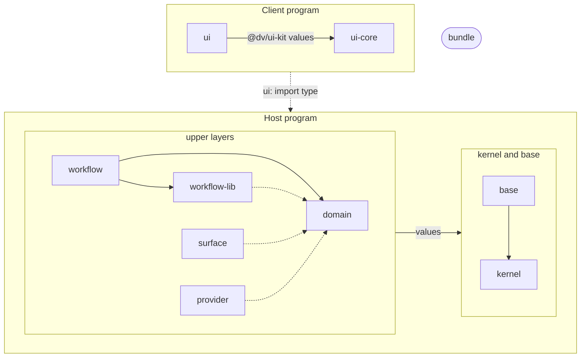
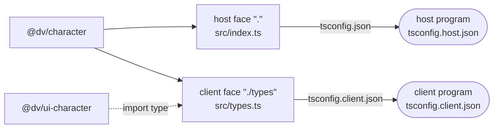
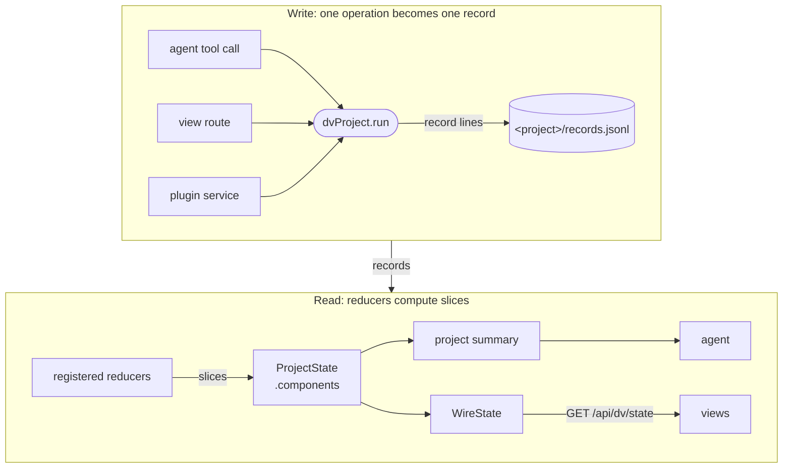

# DreamVerse architecture

English | [中文](architecture.zh.md)

This page maps the DreamVerse packages. It describes the goal, the layers, the import direction, the two faces of a host package, and the flow of project data. The [subsystem pages](subsystems/README.md) are the reference for each part, and the [glossary](glossary.md) defines the names. [DreamVerse architecture checks](architecture-checks.md) describes the scripts that check these rules.

## The goal

Each DreamVerse plugin has one job, and each plugin can be added or removed alone. A plugin is one host package. A plugin with a browser half also has one UI package `@dv/ui-<name>`. The bundle `@dv/bundle` composes each plugin package with one row in `packages/bundle/dv/cordis.patch.yml`. A package depends only on layers that know nothing about it. Thus, when you add or remove a plugin, you edit no package below it and no sibling package. The [layers Agent Note](../../.agents/notes/implemented/architecture/2026-10-17-dv-architecture-layers.md) records why the packages have this structure.

## Layers

The function `layerOf` in [`scripts/dv-architecture.ts`](../../scripts/dv-architecture.ts) infers the layer of each package. No package declares its layer. `layerOf` applies these rules in this order:

1. `project` is the `kernel`, and `packages/bundle/dv` is the `bundle`.
2. The constant `BASE` lists the `base` packages.
3. A package whose `src` calls `dvModels.register(`, and the package `fastvideo-generation-client`, are `provider` packages.
4. `workflow-kit` is the `workflow-lib`, and every other folder `workflow-*` is a `workflow`.
5. The constants `SURFACE` and `UI_CORE` list the `surface` and `ui-core` packages.
6. Every other folder `ui-*` is a `ui` package, and every other package is a `domain` plugin.

When you add a `base`, `surface` or `ui-core` package, add its folder name to `BASE`, `SURFACE` or `UI_CORE`. The diagram shows the ten layers, and every arrow points to a lower layer. A solid arrow is a value import, and a dotted arrow is an `import type`. The client program compiles the browser code of the two UI layers with `tsconfig.client.json`. The host program compiles the Node code of the other layers with `tsconfig.host.json`. The upper layers are the layers above `base`, and every upper layer may import values from `kernel` and `base`. A `ui` package imports values only from `@dv/ui-kit`, and it imports only the types `@dv/<x>/types` from the host program. `@dv/bundle` composes the plugins of both programs and imports no package. The [DreamVerse package table](../../packages/dv/README.md#packages) lists the packages of each layer.

Each layer has one role:

| Layer          | Role                                                                                                                                                                                                                                                                                                                                                      |
| -------------- | --------------------------------------------------------------------------------------------------------------------------------------------------------------------------------------------------------------------------------------------------------------------------------------------------------------------------------------------------------- |
| `kernel`       | The `dvProject` Service. Plugins register component keys, operations, reducers and reference kinds with it, as tools register with `ctx.tools`. The kernel is the only writer of project files. It turns every operation into a DSH tool and registers the `dv:project` system-prompt section. It names no plugin.                                        |
| `base`         | Services and libraries for every domain plugin. The model catalog is the `dvModels` Service Definition with `PrimitiveTypes` and `TaskMap`. `defineGeneration` builds the service of a generation primitive, and `defineReference` builds the service of a reference noun. The base layer also stores the assets of a project and runs external programs. |
| `provider`     | Service Providers of the model catalog. A provider plugin registers the models that it serves, and it ships the prompt skill of each model and task. The client of a provider backend, `<name>-generation-client`, is in this layer too.                                                                                                                  |
| `domain`       | Plugins that each own one component key. A domain plugin owns the data of its key, which is a state slice and its reducer. It also owns the operations of its key and the text that the agent reads about them.                                                                                                                                           |
| `workflow-lib` | The parts of a shot walk that carry no policy. This layer names no workflow.                                                                                                                                                                                                                                                                              |
| `workflow`     | A workflow plugin composes domain plugins into a production flow, for example preview, approval, take reuse and timeline choice.                                                                                                                                                                                                                          |
| `surface`      | Packages that serve the user. `@dv/api` and `@dv/chat-references` run the operations of other packages by name, as the user. A view reads and changes a project only through `@dv/api` ([Agent and API](subsystems/agent-and-api.md)).                                                                                                                    |
| `ui-core`      | The frame of the DreamVerse views in the DSH Web Client. UI core holds the center views, the Right-Sidebar tab types, the registries and slots, and the shared wire types. `@dv/ui-kit` is the library that every UI package shares. UI core names no plugin noun.                                                                                        |
| `ui`           | The browser half of one plugin. A UI package registers into the registries and slots of UI core. `@dv/ui-<x>` pairs with the host package `@dv/<x>` when that package exists.                                                                                                                                                                             |
| `bundle`       | The profile layer that composes the plugins ([the bundle and the packages outside the layers](#the-bundle-and-the-packages-outside-the-layers)).                                                                                                                                                                                                          |

## Import direction

The fitness test checks every `@dv/` import in `src` against this table. A package may always import itself.

| A package in   | May import values from                               | May also `import type` from                                                                                 |
| -------------- | ---------------------------------------------------- | ----------------------------------------------------------------------------------------------------------- |
| `kernel`       | nothing                                              | nothing                                                                                                     |
| `base`         | `kernel`, `base`                                     | nothing more                                                                                                |
| `provider`     | `kernel`, `base`, its own `<name>-generation-client` | a domain package that merges a row into `PrimitiveTypes`                                                    |
| `domain`       | `kernel`, `base`                                     | nothing more                                                                                                |
| `workflow-lib` | `kernel`, `base`                                     | `domain`                                                                                                    |
| `workflow`     | `kernel`, `base`, `domain`, `workflow-lib`           | nothing more                                                                                                |
| `surface`      | `kernel`, `base`                                     | `domain`                                                                                                    |
| `ui-core`      | `@dv/ui-kit`                                         | nothing more                                                                                                |
| `ui`           | `@dv/ui-kit`                                         | `@dv/<x>/types` of its paired host package, and `import type {}` of a UI-core package that merges `SlotMap` |

A domain plugin never imports another domain plugin, and a component never names the operation of another component. Composition across nouns happens only in a workflow. A workflow reaches each domain plugin through its service in `static inject`. For example, `@dv/workflow-story` injects `dvProject`, `dvShotPlan`, `dvShotRender` and `dvTimeline`, and calls `dvShotPlan.shots`, `dvShotRender.estimate` and `dvTimeline.layout`. A UI package never imports another UI package or a value from a host package. It reads its host package only through types.

## Host face and client face

A host package that its UI package reads has two faces. The host face is the package root (`"."` → `src/index.ts`), and it holds the Cordis plugin and its services. The client face is `exports["./types"]` → `src/types.ts`, and it holds the slice and record types that the browser program compiles. Each face belongs to one program. The diagram shows the two faces of `@dv/character` in `packages/dv/character/`, and `@dv/ui-character` reads the client face with `import type`. The package `tsconfig.json` puts the host face into the host program of the root `tsconfig.host.json`. The package `tsconfig.client.json` puts the client face into the client program of the root `tsconfig.client.json`.

A client face has four parts:

1. the `./types` export in `package.json`;
2. a `tsconfig.client.json` beside the host `tsconfig.json`, which includes only `src/types.ts` and references the client configs of the faces that it imports;
3. a path entry `@dv/<pkg>/types` in `tsconfig.base.json`;
4. a reference to that `tsconfig.client.json` in the root `tsconfig.client.json`.

A `src/types.ts` imports and augments only client faces, such as `declare module '@dv/project/types'`. It never imports the bare `@dv/project`. The fitness test follows every module that a `./types` entry reaches. The test fails when one of these modules imports `node:*`, `@deepseek-ai/cordis` or `@deepseek-ai/dsh-tools`. A package has a client face when its `package.json` declares the `./types` export. The [DreamVerse package table](../../packages/dv/README.md#packages) lists the packages.

## Project data

Project data moves in one direction. Three writers call `dvProject.run`: an agent tool call, a view through the route `POST /api/dv/operation` of `@dv/api`, and the service of a plugin through `ctx.dv<Name>.<method>`. `dvProject.run` appends a record line and its update lines to the file `<project>/records.jsonl`. The registered reducers read the records one at a time. Each record passes through every reducer in the order of reducer registration, and each reducer computes its slice of `ProjectState.components`. The agent reads the slices as the project summary, through the `dv_proj_*` tools and the `dv:project` prompt section. The views (the canvas, the timeline, the History panel, and the asset pool) read the slices as `WireState` from `GET /api/dv/state`.

Views and the agent never edit a slice. They write only by running an operation. [Project](subsystems/project.md) owns the records, the operations, the history rules and the project state. [The project summary and the wire state](subsystems/project.md#the-project-summary-and-the-wire-state) describes how a view reads the wire state again after a change.

## Operations and agent tools

Components register their operations with `dvProject.registerOperation` and their reducers with `dvProject.registerReducer`. Each operation is also an agent tool, and one call of that tool becomes one record. [Operations](subsystems/project.md#operations) gives the form of an operation name and of its tool name. The [components table](glossary.md#components-and-packages) of the glossary lists the operations of each component.

An operation declares a resource class (`none`, `cpu` or `gpu`) and a confirmation policy (`never`, `always` or `over_gpu_budget`). [Confirmation in the conversation](subsystems/project.md#confirmation-in-the-conversation) describes the confirmation policies.

A plan approval belongs to a workflow plugin. [Workflows](subsystems/workflows.md) owns the workflow contract and the approval chain.

## The bundle and the packages outside the layers

[`@dv/bundle`](../../packages/bundle/dv/README.md) in `packages/bundle/dv/` is the profile layer. Its `cordis.patch.yml` holds one row for each plugin package. The libraries `@dv/generation`, `@dv/reference-kit`, `@dv/workflow-kit`, `@dv/fastvideo-generation-client` and `@dv/ui-kit` have no row. `scripts/video-harness/setup-profile.sh` stacks the bundle on `dsh-base` plus `dsh-web-app` as the profile `video-harness`, and on `dsh-base` plus `dsh-headless` as `video-harness-headless`. The bundle also ships the `video-directing` skill, the planning procedure across components, which the `skill-filesystem` rows read.

Two packages are outside the ten layers:

- [`@dv/e2e`](../../packages/dv/e2e/README.md) in `packages/dv/e2e/` holds the browser stories. Each story boots the `video-harness` profile with fake services and drives Chromium. The package has no `src`, so no import rule applies to it.
- [`@video-harness/stream`](../../packages/video-harness/README.md) in `packages/video-harness/stream/` sends the video chunks of a render to the browsers ([live render stream](subsystems/shots-and-timeline.md#live-render-stream)). The fitness test scans only `packages/dv/` and `packages/bundle/dv/`, so no rule checks this package.
