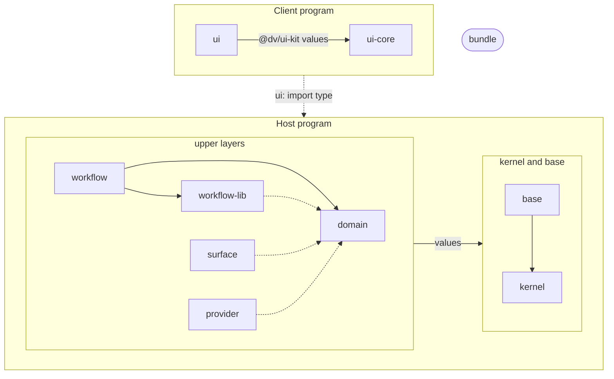
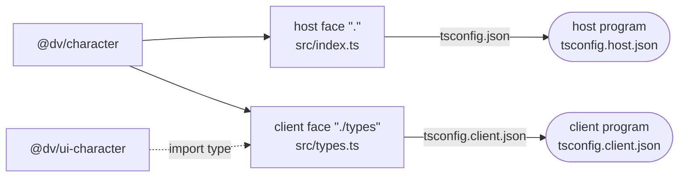
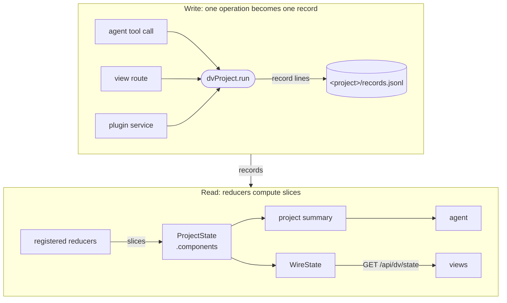

# DreamVerse 架构

[English](architecture.md) | 中文

本页给出 DreamVerse 各包的分布图。它说明目标、层、import 方向、宿主包的两个面，以及项目数据的流向。[子系统页面](subsystems/README.zh.md)是各部分的参考，[术语表](glossary.zh.md)定义各个名称。[DreamVerse 架构检查](architecture-checks.zh.md)说明检查这些规则的脚本。

## 目标

每个 DreamVerse 插件只有一项职责，并且每个插件都能单独加入或移除。一个插件是一个宿主包。有浏览器半部的插件还有一个 UI 包 `@dv/ui-<name>`。bundle `@dv/bundle` 在 `packages/bundle/dv/cordis.patch.yml` 中为每个插件包写一行来组合它。一个包只依赖对它一无所知的层。因此，加入或移除一个插件时，不需要修改它下层的包，也不需要修改同级的包。[分层 Agent Note](../../.agents/notes/implemented/architecture/2026-10-17-dv-architecture-layers.zh.md) 记录了这种结构的理由。

## 层

[`scripts/dv-architecture.ts`](../../scripts/dv-architecture.ts) 中的函数 `layerOf` 推断每个包的层。没有包声明自己的层。`layerOf` 按以下顺序应用这些规则：

1. `project` 是 `kernel`，`packages/bundle/dv` 是 `bundle`。
2. 常量 `BASE` 列出 `base` 包。
3. `src` 中调用 `dvModels.register(` 的包，以及包 `fastvideo-generation-client`，是 `provider` 包。
4. `workflow-kit` 是 `workflow-lib`，其他所有 `workflow-*` 目录是 `workflow`。
5. 常量 `SURFACE` 和 `UI_CORE` 列出 `surface` 和 `ui-core` 包。
6. 其他所有 `ui-*` 目录是 `ui` 包，其他所有包是 `domain` 插件。

新增 `base`、`surface` 或 `ui-core` 包时，把它的目录名加进 `BASE`、`SURFACE` 或 `UI_CORE`。下图给出十个层，每个箭头都指向较低的层。实线箭头是值导入，虚线箭头是 `import type`。客户端程序用 `tsconfig.client.json` 编译两个 UI 层的浏览器代码。宿主程序用 `tsconfig.host.json` 编译其他层的 Node 代码。上层是 `base` 之上的层，每个上层都可以从 `kernel` 和 `base` 导入值。`ui` 包只从 `@dv/ui-kit` 导入值，并且只从宿主程序导入类型 `@dv/<x>/types`。`@dv/bundle` 组合两个程序的插件，它不导入任何包。[DreamVerse 包表](../../packages/dv/README.zh.md#packages)列出每一层的包。

每一层有一个角色：

| 层              | 角色                                                                                                                                                                  |
| -------------- | ------------------------------------------------------------------------------------------------------------------------------------------------------------------- |
| `kernel`       | `dvProject` 服务。插件向它注册组件键、操作、归约函数和引用种类，就像工具向 `ctx.tools` 注册一样。内核是项目文件唯一的写入者。它把每个操作变成一个 DSH 工具，并注册 `dv:project` 系统提示词段。它不点名任何插件。                                      |
| `base`         | 供每个领域插件使用的服务和库。模型目录是 `dvModels` Service Definition 以及 `PrimitiveTypes` 和 `TaskMap`。`defineGeneration` 构建生成原语的服务，`defineReference` 构建引用名词的服务。base 层还存储项目的素材，并运行外部程序。 |
| `provider`     | 模型目录的 Service Provider。提供方插件注册自己服务的模型，并附带每个模型和任务的提示词 skill。提供方后端的客户端 `<name>-generation-client` 也在这一层。                                                              |
| `domain`       | 各自拥有一个组件键的插件。领域插件拥有该键的数据，即一个状态切片及其归约函数。它还拥有该键的操作，以及 agent（智能体）读到的关于它们的文字。                                                                                           |
| `workflow-lib` | 镜头遍历中不带策略的部分。这一层不点名任何工作流。                                                                                                                                           |
| `workflow`     | 工作流插件把领域插件组合成一个制作流程，例如预览、批准、版本（take）复用和时间线选择。                                                                                                                       |
| `surface`      | 服务用户的包。`@dv/api` 和 `@dv/chat-references` 以用户身份按名字运行其他包的操作。视图只通过 `@dv/api` 读取和修改项目（[Agent 和 API](subsystems/agent-and-api.zh.md)）。                                   |
| `ui-core`      | DSH Web 客户端中 DreamVerse 视图的框架。UI 核心持有中央视图、右侧栏标签类型、注册表和 slot，以及共享的协议类型。`@dv/ui-kit` 是每个 UI 包共用的库。UI 核心不点名任何插件名词。                                                     |
| `ui`           | 一个插件的浏览器半部。UI 包向 UI 核心的注册表和 slot 注册。宿主包 `@dv/<x>` 存在时，`@dv/ui-<x>` 与它配对。                                                                                            |
| `bundle`       | 组合各插件的 profile 层（[bundle 和层外的包](#the-bundle-and-the-packages-outside-the-layers)）。                                                                                  |

## import 方向

适应度测试按下表检查 `src` 中的每个 `@dv/` import。一个包总可以 import 它自己。

| 所在层            | 可以 import 值的来源                                 | 还可以 `import type` 的来源                                            |
| -------------- | ---------------------------------------------- | ---------------------------------------------------------------- |
| `kernel`       | 无                                              | 无                                                                |
| `base`         | `kernel`、`base`                                | 无其他                                                              |
| `provider`     | `kernel`、`base`、自己的 `<name>-generation-client` | 向 `PrimitiveTypes` 合并了一行的领域包                                     |
| `domain`       | `kernel`、`base`                                | 无其他                                                              |
| `workflow-lib` | `kernel`、`base`                                | `domain`                                                         |
| `workflow`     | `kernel`、`base`、`domain`、`workflow-lib`        | 无其他                                                              |
| `surface`      | `kernel`、`base`                                | `domain`                                                         |
| `ui-core`      | `@dv/ui-kit`                                   | 无其他                                                              |
| `ui`           | `@dv/ui-kit`                                   | 配对宿主包的 `@dv/<x>/types`，以及合并 `SlotMap` 的 UI 核心包的 `import type {}` |

领域插件从不 import 另一个领域插件，组件也从不写出另一个组件的操作名。跨名词的组合只发生在工作流中。工作流通过 `static inject` 中的服务访问每个领域插件。例如，`@dv/workflow-story` 注入 `dvProject`、`dvShotPlan`、`dvShotRender` 和 `dvTimeline`，并调用 `dvShotPlan.shots`、`dvShotRender.estimate` 和 `dvTimeline.layout`。UI 包从不 import 另一个 UI 包，也不 import 宿主包中的值。它只通过类型读取自己的宿主包。

## 宿主面与客户端面

UI 包需要读取的宿主包有两个面。宿主面是包的根入口（`"."` → `src/index.ts`），它持有 Cordis 插件及其服务。客户端面是 `exports["./types"]` → `src/types.ts`，它持有浏览器程序编译的切片类型和记录类型。每个面属于一个程序。下图给出 `packages/dv/character/` 中 `@dv/character` 的两个面，`@dv/ui-character` 用 `import type` 读取客户端面。包的 `tsconfig.json` 把宿主面放进根 `tsconfig.host.json` 的宿主程序。包的 `tsconfig.client.json` 把客户端面放进根 `tsconfig.client.json` 的客户端程序。

一个客户端面由四部分组成：

1. `package.json` 中的 `./types` 导出；
2. 宿主 `tsconfig.json` 旁边的 `tsconfig.client.json`，它只包含 `src/types.ts`，并引用它所 import 的各个面的客户端配置；
3. `tsconfig.base.json` 中的路径条目 `@dv/<pkg>/types`；
4. 根 `tsconfig.client.json` 中对该 `tsconfig.client.json` 的引用。

`src/types.ts` 只 import 和扩充客户端面，例如 `declare module '@dv/project/types'`。它从不 import 裸的 `@dv/project`。适应度测试追踪 `./types` 入口能到达的每个模块。只要其中一个模块 import 了 `node:*`、`@deepseek-ai/cordis` 或 `@deepseek-ai/dsh-tools`，测试就失败。包的 `package.json` 声明 `./types` 导出时，该包有客户端面。[DreamVerse 包表](../../packages/dv/README.zh.md#packages)列出各包。

## 项目数据

项目数据沿一个方向流动。三类写入方调用 `dvProject.run`：agent 工具调用、经 `@dv/api` 路由 `POST /api/dv/operation` 的视图，以及经 `ctx.dv<Name>.<method>` 的插件服务。`dvProject.run` 向文件 `<project>/records.jsonl` 追加一条记录行及其更新行。已注册的归约函数逐条读取记录。每条记录按归约函数的注册顺序经过每个归约函数，每个归约函数计算 `ProjectState.components` 中自己的切片。agent 以项目摘要的形式读取这些切片，途径是 `dv_proj_*` 工具和 `dv:project` 提示词段。视图（画布、时间线、历史面板和素材库）以 `WireState` 的形式从 `GET /api/dv/state` 读取这些切片。

视图和 agent 从不直接编辑切片。它们只通过运行操作来写入。[项目](subsystems/project.zh.md)页面拥有记录、操作、历史规则和项目状态。[项目摘要和协议状态](subsystems/project.zh.md#the-project-summary-and-the-wire-state)一节说明视图在变化之后如何重新读取协议状态。

## 操作和 agent 工具

组件用 `dvProject.registerOperation` 注册操作，用 `dvProject.registerReducer` 注册归约函数。每个操作同时是一个 agent 工具，该工具的一次调用成为一条记录。[操作](subsystems/project.zh.md#operations)给出操作名和其工具名的格式。术语表的[组件表](glossary.zh.md#components-and-packages)列出每个组件的操作。

操作声明资源类别（`none`、`cpu` 或 `gpu`）和确认策略（`never`、`always` 或 `over_gpu_budget`）。[在对话中确认](subsystems/project.zh.md#confirmation-in-the-conversation)说明各确认策略。

分镜计划的批准属于工作流插件。[工作流](subsystems/workflows.zh.md)页面拥有工作流约定和审批链。

## bundle 和层外的包

`packages/bundle/dv/` 中的 [`@dv/bundle`](../../packages/bundle/dv/README.zh.md) 是 profile 层。它的 `cordis.patch.yml` 为每个插件包写一行。库 `@dv/generation`、`@dv/reference-kit`、`@dv/workflow-kit`、`@dv/fastvideo-generation-client` 和 `@dv/ui-kit` 没有对应的行。`scripts/video-harness/setup-profile.sh` 把 bundle 叠在 `dsh-base` 加 `dsh-web-app` 上组成 profile `video-harness`，叠在 `dsh-base` 加 `dsh-headless` 上组成 `video-harness-headless`。bundle 还附带 `video-directing` skill，即跨组件的规划流程，由 `skill-filesystem` 行读取。

两个包在十个层之外：

- `packages/dv/e2e/` 中的 [`@dv/e2e`](../../packages/dv/e2e/README.zh.md) 存放浏览器故事。每个故事用假服务启动 `video-harness` profile，并驱动 Chromium。该包没有 `src`，因此 import 规则不适用于它。
- `packages/video-harness/stream/` 中的 [`@video-harness/stream`](../../packages/video-harness/README.zh.md) 把渲染的视频分块发送给浏览器（[实时渲染流](subsystems/shots-and-timeline.zh.md#live-render-stream)）。适应度测试只扫描 `packages/dv/` 和 `packages/bundle/dv/`，因此没有规则检查这个包。
