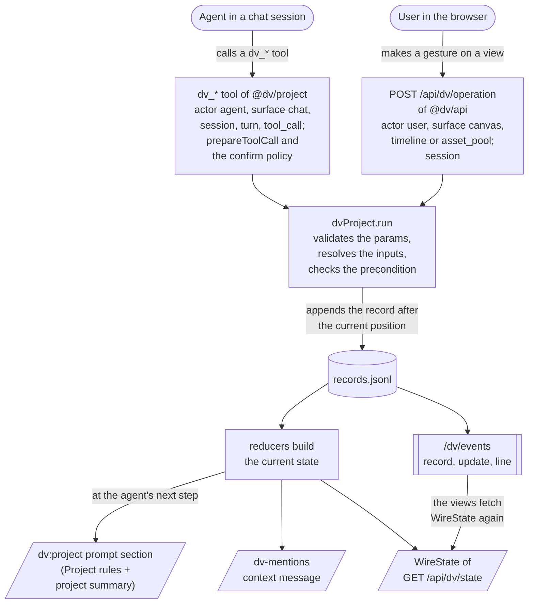

# Agent and API

English | [中文](agent-and-api.zh.md)

The agent and the browser reach a DreamVerse project through the packages of this page. [`@dv/api`](../../../packages/dv/api/README.md) provides the `dvApi` service: the `/api/dv/*` routes and the `/dv/events` stream, which the UI packages in the browser consume ([User interface](ui.md)). [`@dv/chat-references`](../../../packages/dv/chat-references/README.md) provides the `dvChatReferences` service, which acts at the `agent/pre-step` waterfall and at each `user/message` session event. Both services inject `dvProject`. [Assets](assets.md) lists the packages that inject `dvAssetPool`. [`@dv/mcp-presets`](../../../packages/dv/mcp-presets/README.md) provides no service. It consumes the optional `mcpServers` service of the DSH MCP plugin. [`@dv/project`](../../../packages/dv/project/README.md) builds the `dv_*` tools and the `dv:project` prompt section. The browser halves [`@dv/ui-mcp-presets` and `@dv/ui-skills`](ui.md#ui-core-and-ui-plugins) are on the user interface page.

## What the agent reads

The agent reads a project through three channels, each owned by the package that owns its content:

- **Tools.** Each operation's `description` says how to use its tool; [`@dv/project`](../../../packages/dv/project/README.md) builds the tool from the `OperationSpec`.
- **The `dv:project` prompt section.** `@dv/project` registers it while the DSH `systemPrompt` service is mounted. The section starts with Project's rules. The rules cover the history list, undo and redo, confirmation in the conversation, and stale records. They also tell how to name records, assets, versions, and other items. Then the section holds the project summary of the current state. It holds nothing that the user cannot see, such as a selection in a view or a preference.
- **Chat references.** At `agent/pre-step`, [`@dv/chat-references`](../../../packages/dv/chat-references/README.md) expands the `dv:` mentions that the composer writes for `@` and `+ → 引用`. The result is one context message with concrete record and asset IDs. The package also imports the files that a user attaches in the chat, with `asset.import` as the user. It puts those files and the assets that a message mentions on the canvas. The next tool call of the session waits for the import ([chat references](#chat-references)).

Skills hold procedures and model-specific rules, each registered by its owner:

| Skill                                                 | Owner                                                                                       | Registered through               | Content                                                                                                                                                                                                                      |
| ----------------------------------------------------- | ------------------------------------------------------------------------------------------- | -------------------------------- | ---------------------------------------------------------------------------------------------------------------------------------------------------------------------------------------------------------------------------- |
| `video-directing`                                     | [`@dv/bundle`](../../../packages/bundle/dv/README.md) (`skills/video-directing`)               | the `skill-filesystem` directory | The planning procedure across components: the story and its shots, a model and inputs per shot, prompts written with the prompt skill of that model and task, retakes and stale shots                                        |
| `timeline-editing`                                    | [`@dv/timeline`](../../../packages/dv/timeline/README.md)                                      | `ctx.skills`                     | Editing timelines and clips                                                                                                                                                                                                  |
| `character`                                           | [`@dv/character`](../../../packages/dv/character/README.md)                                    | `ctx.skills`                     | Creating and updating characters, with the arguments of each tool                                                                                                                                                            |
| `location`                                            | [`@dv/location`](../../../packages/dv/location/README.md)                                      | `ctx.skills`                     | Creating and updating locations, with the arguments of each tool                                                                                                                                                             |
| `style`                                               | [`@dv/style`](../../../packages/dv/style/README.md)                                            | `ctx.skills`                     | Creating and updating styles, with the arguments of each tool                                                                                                                                                                |
| `story-directing`                                     | [`@dv/workflow-story`](../../../packages/dv/workflow-story/README.md)                          | `ctx.skills`                     | The order of calls from planned shots to rendered shots: create or update the plan, preview it, ask the user, approve it, wait                                                                                               |
| `video-model-selection`                               | [`@dv/models`](../../../packages/dv/models/README.md)                                          | `ctx.skills`                     | Choosing the model of each shot with `dv_models_list` and `dv_models_get`, and when to ask the user                                                                                                                          |
| `fasth3-reference-prompting`, `fasth3-text-prompting` | the provider plugin of the model ([`@dv/fastvideo`](../../../packages/dv/fastvideo/README.md)) | `ctx.skills`                     | The model's limits and prompt rules for that task                                                                                                                                                                            |

## Chat references

The composer writes a mention as `@[<label>](dv:<kind>/<id>)`. At `agent/pre-step`, `dvChatReferences` reads the `dv:` mentions of the step's new user messages. It appends one user message with the source kind `dv-mentions`. The message starts with "The user referenced these project items:" and holds one line for each mention:

| Mention                                                          | The line gives                                                                                                              |
| ---------------------------------------------------------------- | --------------------------------------------------------------------------------------------------------------------------- |
| `dv:asset/<AssetId>`                                             | The asset ID and the record that made the asset, or "imported (no producing record)"                                        |
| `dv:record/<RecordId>`                                           | The record that the ID names                                                                                                |
| `dv:clip/<ClipId>`                                               | The timeline of the clip, its 1-based position, and its asset; a placeholder clip names the render record that it waits for |
| `dv:<kind>/<id>`, for a kind of `dvProject.listReferenceKinds()` | The newest version `<id>@<version>` and its reference assets, to pass as an input                                           |
| any other kind                                                   | "unknown mention kind"                                                                                                      |

A line that names a record gives its tool name, its status, its prompt and duration when it has them, its inputs, and its outputs. The line tells the agent to call the tool again with `based_on` to change it. The mentions resolve against the current state of one project. This is the project bound to the chat session, else the newest project whose records made a mentioned asset, else the newest project. When no project exists, each line tells the agent to call `dv_proj_open` first.

At each `user/message` event of a message that the user typed in a live agent session, `dvChatReferences` does two writes:

1. It imports each attached image or file with one `asset.import` that has `place: true`, as `actor: 'user'` and `surface: 'chat'`. An image keeps the media type of its block. Any other file takes the media type of its file name extension, else `application/octet-stream`. `dvProject.holdToolCalls` makes the next tool call of the session wait for the imports.
2. It puts the assets of the message's `dv:asset` mentions on the canvas with one `asset.place` by the user. Only the assets that `asset.place` accepts and that are not on the canvas yet count.

A session without a bound project imports and places nothing. A failed import or placement writes a warning to the `dvChatReferences` log.

## The API routes

[`@dv/api`](../../../packages/dv/api/README.md) is the HTTP face of Project for the browser. Its routes do these jobs:

- `GET /api/dv/state` returns the current state of a project as one JSON document.
- `GET /api/dv/operations` lists the registered operations.
- `POST /api/dv/operation` runs any registered operation as the user, with `surface: 'canvas'`, `'timeline'`, or `'asset_pool'`.
- `POST /api/dv/history` returns one page of the history.
- `POST /api/dv/undo` and `POST /api/dv/redo` move the current position.
- `POST /api/dv/stale/accept` runs `proj.stale_accept`.
- Other routes manage projects, task labels, asset imports, canvas layouts (node positions and the viewport), and Workspace links.
- `GET /dv/events` streams every record append, record update, and move of the current position.

The [`@dv/api` README](../../../packages/dv/api/README.md#use-this-package) gives the request and the response of each route. [User interface](ui.md#views) gives the views that use these routes.

## The agent path and the HTTP path

The agent and the views run the same operations through `dvProject.run`. Each side reads the project in its own form. The agent reads the `dv:project` prompt section and the chat reference message. The views read `WireState` from `GET /api/dv/state`. [The wire state](project.md#the-project-summary-and-the-wire-state) gives its fields and when a view fetches it again. [How an operation runs](project.md#how-an-operation-runs) gives the steps of the runner.

## MCP presets

`@dv/mcp-presets` (plugin name `dv-mcp-presets`) chooses the MCP servers that DreamVerse suggests. Its `presets` config maps a server name to a `title`, a `description`, and a server `spec`. While the `mcpServers` service of the DSH MCP plugin is mounted, the plugin offers the presets with `mcpServers.offerPresets()` in an effect. When the MCP plugin turns off, the effect withdraws the offer. Offering a preset adds no server and no tool. A person adds the server from the MCP tab of the entry page, which `@dv/ui-mcp-presets` draws. The [`@dv/mcp-presets` README](../../../packages/dv/mcp-presets/README.md) lists the presets of the DreamVerse bundle.
