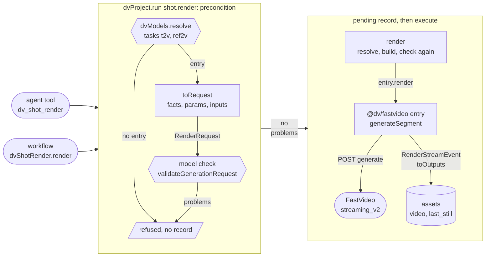

# 生成

[English](generation.md) | 中文

本页是 DreamVerse 生成的参考。它描述模型目录、生成辅助库、镜头渲染操作，以及提供模型的提供方插件。模型目录是 [`@dv/models`](../../../packages/dv/models/README.zh.md) 的 `dvModels` 服务。生成辅助库是库 [`@dv/generation`](../../../packages/dv/generation/README.zh.md) 的 `defineGeneration`。提供方插件（如 [`@dv/fastvideo`](../../../packages/dv/fastvideo/README.zh.md)）向模型目录注册模型条目。[`@dv/shot-render`](../../../packages/dv/shot-render/README.zh.md) 使用模型目录，并用生成辅助库构建自己的服务。故事工作流 `@dv/workflow-story` 通过 `GenerationApi` 调用 `dvShotRender`，[`@dv/api`](../../../packages/dv/api/README.zh.md) 在 `GET /api/dv/tasks` 提供模型目录的生成任务标签。[生成 Agent Note](../../../.agents/notes/implemented/architecture/2026-10-17-dv-architecture-generation.zh.md) 记录生成为什么分成这几部分。

## 模型目录

模型目录是一个能力 seam。`@dv/models` 持有 Service Definition，提供方插件是它的 Service Provider，每个原语包（例如 `@dv/shot-render`）是一个 Consumer。模型目录保存模型条目。一个条目是一个提供方的一个模型服务一个生成任务。条目的键有四个字段，写作 `modality/task/provider/model`，例如 `video/ref2v/fastvideo/fasth3`。服务两个生成任务的模型有两个条目。模型目录不注册操作，也不写记录。

`packages/dv/models/src/types.ts` 中的两个开放接口给出条目的类型：

| 接口             | 一行                                                                           | 行的值                                                                                       |
| ---------------- | ------------------------------------------------------------------------------ | -------------------------------------------------------------------------------------------- |
| `PrimitiveTypes` | 一个原语：一次模型调用的一种输入和输出签名，例如 `video`                       | `modality`、`facts`（构建请求所依据的事实）、`request`、`render` 的 `result` 和 `entry` 字段 |
| `TaskMap`        | 一个生成任务：模型使用哪些输入，例如 `t2v`（只有提示词）或 `ref2v`（参考素材） | 该生成任务运行在其上的原语                                                                   |

模型目录只声明 `video` 行（entry 字段为 `gpuSecondsPerVideoSecond`）以及生成任务 `t2v` 和 `ref2v`。原语包在自己的源码中用 `declare module '@dv/models'` 添加自己的行和生成任务。`ModelEntry<T>` 取生成任务 `T` 所在行的 facts、request、result 和 entry 字段。`TaskOfPrimitive
` 是原语 `P` 的生成任务的联合类型，例如 `video` 的 `t2v | ref2v`。[`@dv/models` README](../../../packages/dv/models/README.zh.md#model-keys) 定义每个键字段、每个条目成员、渲染请求和渲染流。

## 模型目录的读取

Consumer 只通过自己的生成任务列表读取条目。Consumer 调用 `dvModels` 的以下方法：

- `dvModels.resolve(tasks, params)` 返回 `modality`、`task`、`provider` 和 `model` 参数所指定的条目，前提是该条目的生成任务在 `tasks` 中。否则它抛出一个错误，错误写出键和工具 `dv_models_list`。[`@dv/models` README](../../../packages/dv/models/README.zh.md#use-this-package) 给出错误文字。
- `dvModels.whileServing(tasks, start)` 在模型目录得到 `tasks` 中某个生成任务的第一个条目时调用 `start`。模型目录失去最后一个这样的条目时，它释放 `start` 返回的注册。
- `dvModels.labelTasks(labels)` 保存原语声明列出的每个生成任务的中文和英文标签。`@dv/api` 在 `GET /api/dv/tasks` 提供这些标签，UI 包用 `@dv/ui-kit` 的 `taskLabel` 显示它们。

agent（智能体）只通过两个工具读取条目：

- 工具 `dv_models_list` 返回与其可选参数 `modality`、`task` 和 `provider` 匹配的每个条目的键、描述和提示词 skill 名称。
- 工具 `dv_models_get` 返回一个条目的键、描述和 `schema()`。`schema()` 给出限制、输入及其媒体类型和数量，以及 `extra` 的参数。

这两个工具不点名任何媒体类型，模型目录也不向系统提示词添加任何内容。

## `defineGeneration` 与 `GenerationApi`

`defineGeneration(spec)` 接收一个原语的声明（一个 `GenerationSpec`），返回一个 Cordis 服务类。该服务注入 `dvProject` 和 `dvModels`。它在存续期间注册一个组件键和生成任务标签。它通过 `whileServing` 注册一个操作，因此操作及其 agent 工具只在有模型服务该操作的某个生成任务期间存在。生成辅助库不点名任何原语。

生成辅助库设定操作中不依赖签名的部分：

- 参数依次是四个键字段和 `prompt`，然后是声明自己的参数，最后是 `seed` 和 `extra`。带 `seed: false` 的声明没有 `seed`。
- 每个生成操作都有 `deterministic: false`、`resource: 'gpu'`、`confirm: 'over_gpu_budget'` 和 `version: '1'`。
- 在写任何记录之前，precondition 用 `check` 的理由拒绝调用。agent 工具在 `prepareToolCall` 中运行同样的检查，时间在项目组件请用户同意之前。
- `execute` 解析条目，再次构建请求，并在 `render` 之前调用条目的 `validateGenerationRequest`。
- `toOutputs` 没有报告成本时，记录以声明的估计值作为成本。报告包含种子。

声明提供不同的代码。`toRequest` 由条目的事实、参数、输入和种子构建请求。`toOutputs` 把结果导入为输出。`toOutputs` 可以调用 `@dv/generation` 的辅助函数 `importOne`，它把一个输出导入为运行中记录的素材。`estimate` 由参数和条目给出 GPU 秒数，`summarize` 为一条记录给出一行文字。`confirmText`、`toolParams` 和 `prepareToolCall` 是可选的。

该服务还为工作流实现 `GenerationApi`：`render`、`check`、`estimate`、`findTake` 和 `parseInputs`。`check` 从不写入。`check` 接收链式角色，即调用方安排在被检查的调用之前产出的输入角色。链式角色以 `ref: null` 到达 `toRequest`。角色计数和提示词引用能看到链式角色，而模型检查等到 `execute` 才运行。[`@dv/generation` README](../../../packages/dv/generation/README.zh.md) 定义每个 `GenerationSpec` 字段和每个 `GenerationApi` 方法。[添加生成原语](../cookbook/adding-a-generation-primitive.zh.md)给出添加原语的步骤。

## `shot.render`

`@dv/shot-render` 是 `video` 原语的原语包。它的服务 `dvShotRender` 是对一个声明调用 `defineGeneration` 的结果：

| 字段             | 值                                                                                                             |
| ---------------- | -------------------------------------------------------------------------------------------------------------- |
| 组件、操作、工具 | `shot`、`shot.render`、`dv_shot_render`                                                                        |
| 原语和生成任务   | `video`；`t2v`（文字生成 / From text）和 `ref2v`（参考图生成 / From references）                               |
| 自己的参数       | `duration_sec`、`aspect_ratio` 和 `resolution`                                                                 |
| 输入             | `reference`（多个，带版本）和 `first_frame`（一张图片）                                                        |
| 输出             | `video` 和 `last_still`                                                                                        |
| 仅限工具的参数   | `continue_from`：一条渲染记录；`prepareToolCall` 把它的输出 `#1` 加为 `first_frame` 输入 `{record, output: 1}` |
| 估计值           | `duration_sec`（调用未指定时为 5）乘以条目的 `gpuSecondsPerVideoSecond`                                        |

在写下记录之前，对每个调用方，`shot.render` 在以下情况拒绝调用：

- 键没有指定生成任务 `t2v` 或 `ref2v` 的模型目录条目。
- 缺少提示词。
- 提示词引用了不在 `reference` 输入中的素材。
- 提示词引用了调用没有的输入角色。
- 提示词引用了素材和输入以外的任何内容。
- `aspect_ratio`、`resolution` 或 `duration_sec` 超出条目的事实。
- 调用有多于一个的 `first_frame` 输入。
- 条目的 `validateGenerationRequest` 拒绝渲染请求。

每个条目的 `validateGenerationRequest(request)` 负责其模型的请求规则。例如，这些规则在以下情况拒绝请求：

- 某个输入的媒体类型或数量不被模型接受。例如，`fasth3` 在生成任务 `ref2v` 下至少需要一个参考素材。
- 请求带首帧，而模型不接受首帧。
- 某个 `extra` 值对该模型无效。

`shot.render` 构建请求，自己不检查任何模型规则。当某个输入是未完成记录的输出时，precondition 跳过模型检查，由 `execute` 在渲染前运行它。此时的拒绝让记录失败。挂载 `@video-harness/stream` 时，视频分块还会在渲染期间发给浏览器（[实时渲染流](shots-and-timeline.zh.md#live-render-stream)）。

## 模型线 skill

模型目录拥有运行时 skill `video-model-selection`，即 agent 为每个镜头选择模型时遵循的步骤。提供方以 `ModelEntry.promptSkill` 为每个模型和生成任务提供一个提示词 skill。模型目录在条目注册期间注册其提示词 skill，提供方自己不注册任何 skill。只有 agent 加载这些 skill；用户不能从输入框调用它们。模型目录或提供方的 skill 不点名消费方的任何操作或工具（例如 `shot.render` 或 `dv_shot_render`）。它也不使用 `plan` 这类工作流词。`scripts/dv-architecture.ts` 的规则 R8 检查这些 skill；[适应度测试 Agent Note](../../../.agents/notes/implemented/process/2026-10-17-dv-architecture-fitness-test.zh.md) 负责该规则。

## 提供方

两个包把 FastVideo 后端接入模型目录：

| 包                                                                                                 | 注册的内容                                                                                                                                                                                                    |
| -------------------------------------------------------------------------------------------------- | ------------------------------------------------------------------------------------------------------------------------------------------------------------------------------------------------------------- |
| [`@dv/fastvideo`](../../../packages/dv/fastvideo/README.zh.md)                                     | 为 `models` 配置中的每个模型和生成任务注册一个提供方为 `fastvideo` 的模型目录条目。它为生成任务 `ref2v` 和 `t2v` 提供模型 `fasth3`，提示词 skill 为 `fasth3-reference-prompting` 和 `fasth3-text-prompting`。 |
| [`@dv/fastvideo-generation-client`](../../../packages/dv/fastvideo-generation-client/README.zh.md) | `dvFastvideoGeneration` 服务，即一个 FastVideo streaming_v2 后端的客户端。它不注册模型目录条目，也不注册工具。                                                                                                |

插件 `dv-fastvideo` 遵循以下规则：

- 插件在启动时检查配置。未知模型、未知生成任务或没有生成任务的模型都会让插件停止。
- 配置为每个模型和生成任务给出自己的服务器（`baseUrl`）和 GPU 速率（`gpuSecondsPerVideoSecond`）。
- 插件为每个条目在一个隔离的 `dvFastvideoGeneration` 作用域中构建一个客户端。
- 条目通过自己的客户端从 `GET /v1/streamv2/capabilities` 读取 `facts()` 和 `schema()`。[客户端 README](../../../packages/dv/fastvideo-generation-client/README.zh.md#use-this-package) 定义客户端如何缓存这个应答。
- `render` 从 `dvAssetPool` 读取每个输入素材。它把提示词中的每个引用替换为模型读取的标签，例如 `<Picture 1>`。然后它发送一次 `POST /v1/streamv2/generate`。

`@dv/bundle` 的 `dv-fastvideo` 行挂载该插件，每个生成任务一个服务器。没有 bundle 行挂载客户端包。要添加提供方、模型或服务器，请按仓库 skill [`dv-add-model-provider`](../../../.agents/skills/dv-add-model-provider/SKILL.md) 操作。这些改动都不修改 `@dv/models`。

## 一次渲染请求经过模型目录的路径

agent 调用和工作流调用的渲染请求走同一条路径。precondition 的步骤在写下记录之前运行；渲染的步骤在 `execute` 中运行。

