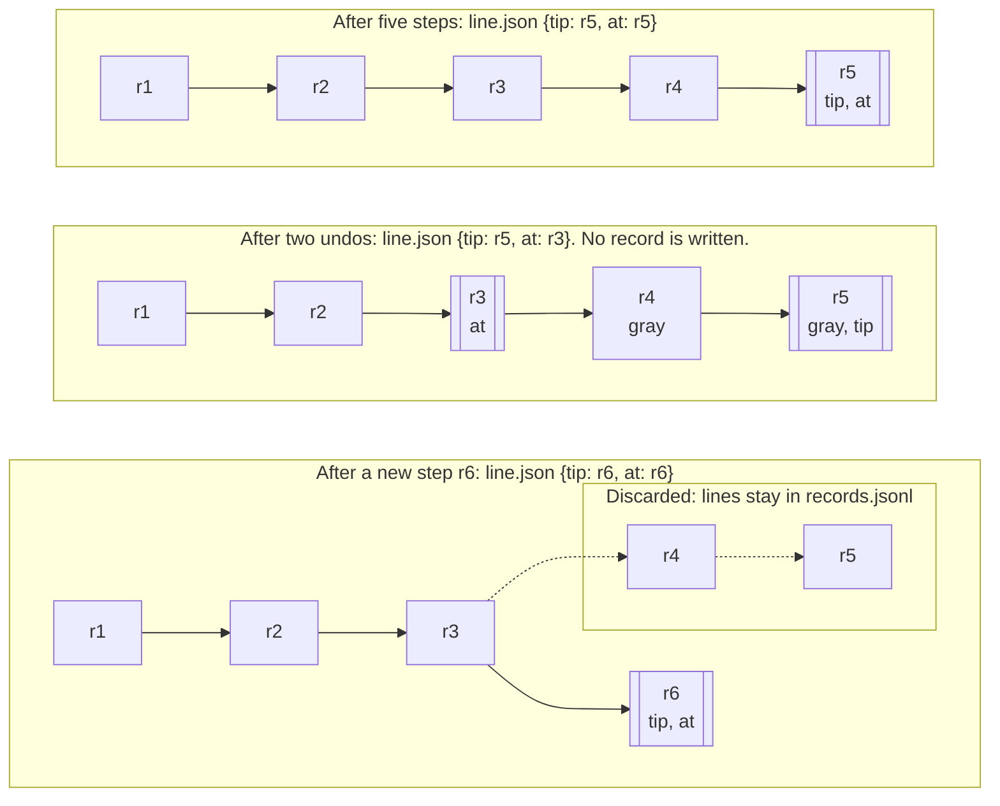
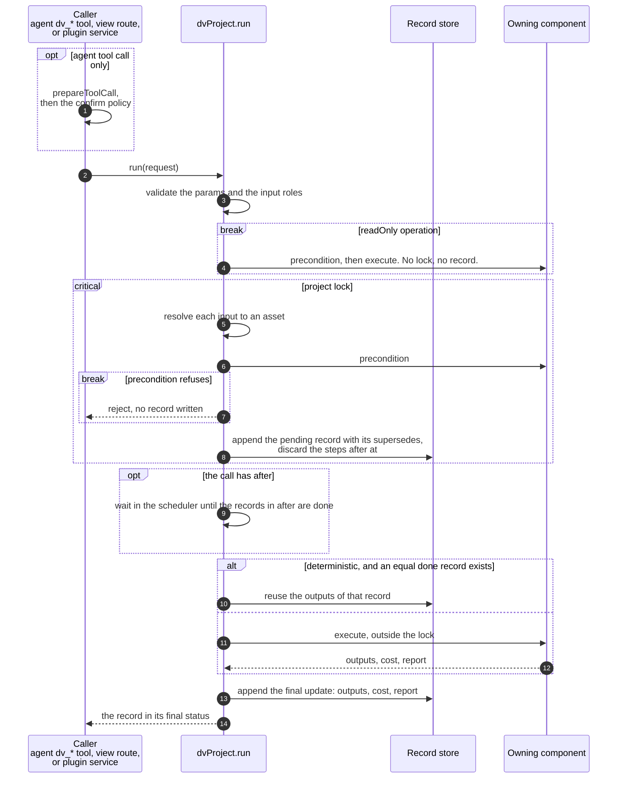
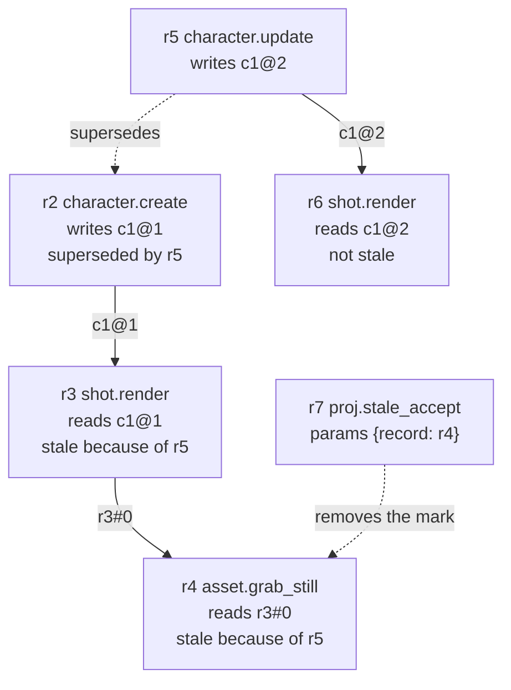

# Project

English | [中文](project.zh.md)

`@dv/project` provides the `dvProject` Cordis service, the kernel of DreamVerse. The kernel owns the record log, the history list, the operation runner and its scheduler, the stale marks, and the agent tool of each operation. The kernel names no plugin. Plugins register their component keys, reducers, reference kinds, and operations into the kernel. The [data-flow Agent Note](../../../.agents/notes/implemented/architecture/2026-10-17-dv-architecture-data-flow.md) gives the reasons for this design. The [package README](../../../packages/dv/project/README.md) holds the configuration, the methods, and the text that the model sees. [`CONTRACTS.md`](../../../packages/dv/project/CONTRACTS.md) specifies each internal module. These packages use `dvProject`:

- The component plugins [`@dv/asset-pool`](../../../packages/dv/asset-pool/README.md), [`@dv/inspector`](../../../packages/dv/inspector/README.md), [`@dv/shot-plan`](../../../packages/dv/shot-plan/README.md), [`@dv/timeline`](../../../packages/dv/timeline/README.md), and [`@dv/workflow-story`](../../../packages/dv/workflow-story/README.md).
- The plugins that [`@dv/generation`](../../../packages/dv/generation/README.md) builds (`@dv/shot-render`) and that [`@dv/reference-kit`](../../../packages/dv/reference-kit/README.md) builds (`@dv/character`, `@dv/location`, and `@dv/style`).
- The interface packages [`@dv/api`](../../../packages/dv/api/README.md) and [`@dv/chat-references`](../../../packages/dv/chat-references/README.md).

## The operation record

Every change to a project is one record in the `records.jsonl` file of the project. Only `@dv/project` reads and writes that file. Every record has `kind: 'operation'` and is one call of one operation. A record holds these fields:

- `actor` tells who made the call. The value is `user`, `agent`, or `system`.
- `surface` tells where the call came from. The value is `chat`, `canvas`, `timeline`, `asset_pool`, `history`, or `api`.
- `intent` tells why. The value is the `reason` argument of the agent, or a short description of the gesture of the human.
- `component`, `operation`, and `operation_version` name the owning component, the operation, and the version of the operation.
- `params` holds the params. `inputs` holds the inputs, each with the asset that the input resolved to (`resolved_asset`).
- `outputs`, `status`, and `parents` hold the outputs, the status, and the parent record.
- `based_on` names a record that this record repeats with changes, such as a take with an edited prompt.
- `supersedes` names the records whose outputs this record replaces.
- `session`, `turn`, and `tool_call` link the record to the DSH session log of the chat session that made the record. They hold the chat session ID, the DSH turn number of that session, and the tool call ID.

The conversation itself stays in the session log. The record store appends records and never rewrites them. The record store appends a status change, the cost, and the report as an update line. The parent of each record is the current position of the project when the record store appends the record ([history rules](#history-rules)). The actions of Project itself are records too, such as `proj.create` and `proj.stale_accept`. Undo, redo, and a move to a step write no record. Reads write no record either, such as `dv_proj_state`, `dv_proj_history_list`, and the `inspect.*` operations.

## The record log

Each project is one directory, `<root>/<ProjectId>/`, where `<root>` is the `root` setting of `dvProject`. The record store module `record-store.ts` is the only code that reads or writes the three files of the directory:

| File            | Content                                                                                                          | How it changes                                                                                 |
| --------------- | ---------------------------------------------------------------------------------------------------------------- | ---------------------------------------------------------------------------------------------- |
| `project.json`  | `ProjectInfo`: the project `id`, the `title`, and `created_at`                                                   | A rename writes a temporary file and renames it into place                                     |
| `records.jsonl` | One record line for each record, and one update line `{"update": <record>, …}` for each later change of a record | Append only; the line order is the write order                                                 |
| `line.json`     | `{tip, at}` ([history rules](#history-rules))                                                                    | Each append and each move rewrites it atomically; a project without records has no `line.json` |

An update line sets only the fields that change after the append: `status`, `started_at`, `finished_at`, `outputs`, `error`, `cost`, and `report`. The `status` moves only forward. It goes from `pending` to `running`, and then to `done`, `failed`, or `cancelled`. A `pending` status can also go directly to one of the last three. Every module and every reducer reads a record in its current form. The current form is the record line with each of its update lines applied in order. An input can name the output of an unfinished record. In the current form, that input gets its `resolved_asset` when the producer record is `done`. The record store never writes this value to disk.

## History rules

These rules tell which changes are steps. They also tell what undo, redo, and "go back to a step" do. The rules apply to the user, the agent, and the system. The model is the same as the History panel of an image editor.

1. **A change to the project content is a step.**
   - The project content is the assets, the assets on the canvas, the characters, locations and styles, the plans, the renders, the timelines, and the exports.
   - The steps of the user and the steps of the agent are in one history list, in the sequence of time.
   - A change to the view is not a step. The view is the pan, the zoom, the node positions, the selection, the shown view, and the open panels.
   - A change to the project name is not a step. The deletion of a project is not a step.
2. **Undo, redo, and "go back to a step" move the current position.**
   - The current position is one step of the history list. The project shows its state at that step.
   - Undo moves the current position back one step. Ctrl+Z, the undo button, and `dv_proj_undo` do an undo.
   - Redo moves the current position forward one step. Shift+Ctrl+Z, the redo button, and `dv_proj_redo` do a redo.
   - "Go back to a step" moves the current position to the step that you select. 回到这一步 in the ⋮ menu of a History row does this. `dv_proj_undo` with `to` also does this.
   - These moves do not add a step to the history list.
3. **A new step after the current position discards the later steps.**
   - If the current position is not the last step, the History panel shows the later steps in gray.
   - If you or the agent make a new step at that time, the history list discards the later steps.
   - You cannot get a discarded step back.
   - If a discarded step is not complete, the system cancels it. For example, a render stops.
4. **An imported asset stays; a generated asset follows the current position.**
   - An imported asset is an asset that a step imports. An imported asset stays in the asset pool, also when its step is discarded.
   - A generated asset is an asset that a step makes, for example a render, a still, or an export. A generated asset shows in the asset pool only when its step is at or before the current position.
   - The files of all assets stay on the disk.

`@dv/project` implements these rules. Each project has a `line.json` file with `{tip, at}`. `tip` is the last step, and the history list is the `parents[0]` ancestry of `tip`. `at` is the current position. Undo, redo, and a move to a step change `at` and write no record. A write appends its record after `at` and sets both `tip` and `at` to that record. So the steps that were after `at` leave the history list, and their lines stay in `records.jsonl`. The runner cancels each of those steps that has not finished, with `error.code: 'discarded'`. Three methods of `dvProject` move `at`, and each method refuses some moves:

- `dvProject.undo` refuses a move back from the first record with `nothing_to_undo`.
- `dvProject.redo` refuses a move forward from the last step with `nothing_to_redo`.
- `dvProject.moveTo` refuses an unknown record with `unknown_record` and a discarded record with `invalid_params`.

The diagram shows the history list of one project in three states. The names `r1` to `r6` stand for record IDs.

## Components

A component key names the part of a project that one plugin owns: its operations, its records, and its state slice. The kernel registers only its own key `proj` and keeps no list of other keys. A plugin registers its key before its reducer, its reference kinds, and its operations. The plugin makes each registration inside `ctx.effect`, so the disposal of the plugin removes the registration. Each registration method of `dvProject` refuses a registration that breaks its rule:

| Method                          | Registers                                                | Refused with                                                                                                                                                                        |
| ------------------------------- | -------------------------------------------------------- | ----------------------------------------------------------------------------------------------------------------------------------------------------------------------------------- |
| `registerComponent(key)`        | A component key                                          | `component_exists` for a key that is registered                                                                                                                                     |
| `registerReducer(key, reducer)` | The reducer of the key's state slice                     | `invalid_params` for an unregistered key; `reducer_exists` for a second reducer of one key                                                                                          |
| `registerReferenceKind(spec)`   | A reference kind ([input references](#input-references)) | `invalid_params` for an unregistered component and for the kinds `asset`, `record`, and `version`; `kind_exists` for a second owner of one kind                                     |
| `registerOperation(spec)`       | An operation and its agent tool                          | `operation_exists` for a registered name; `invalid_params` for an unregistered component, a name outside `<component>.`, or a `confirm` other than `never` without `confirmSummary` |

A key can have no reducer.

## Operations

An operation name has the form `<key>.<verb>` or `<key>.<object>_<verb>`, where `<key>` is the owning component key. Examples are `asset.import` and `timeline.clip_move`. The agent tool of an operation is `dv_` followed by the name with each dot changed to `_`, such as `dv_timeline_clip_move`. A plugin runs only its own operations. Another plugin reaches them through the typed Cordis service of the owning plugin. For example, `dvTimeline.layout` runs `timeline.create` or `timeline.update`.

An `OperationSpec` in `packages/dv/project/src/operation-types.ts` declares one operation. Its JSDoc defines each member. The kernel and the other packages read the members at these points:

| Members                                                    | Read by                                                                                                                                                              |
| ---------------------------------------------------------- | -------------------------------------------------------------------------------------------------------------------------------------------------------------------- |
| `name`, `component`, `version`                             | The runner, which writes them to the record as `operation`, `component`, and `operation_version`                                                                     |
| `description`, `params`, `toolParams`, `inputs`, `outputs` | The agent tool and the canvas form; the runner validates `params` and refuses an input role that `inputs` does not declare                                           |
| `label`                                                    | `toWireOperation` in `@dv/api`, which sends it in `GET /api/dv/operations`, and `operationLabel` in `@dv/ui-kit`                                                     |
| `prepareToolCall`, `confirm`, `confirmSummary`, `estimate` | The agent tool, before it calls `dvProject.run` ([confirmation in the conversation](#confirmation-in-the-conversation))                                              |
| `precondition`, `supersedes`                               | The runner, under the project lock ([how an operation runs](#how-an-operation-runs))                                                                                 |
| `pendingInputRoles`                                        | The runner and the scheduler ([input references](#input-references))                                                                                                 |
| `deterministic`                                            | The runner ([deterministic reuse](#deterministic-reuse))                                                                                                             |
| `resource`                                                 | The scheduler, which limits `gpu` and `cpu` calls by the [concurrency settings](../../../packages/dv/project/README.md#use-this-package); `none` calls have no limit |
| `readOnly`                                                 | The runner, which writes no record and takes no lock for a read-only operation                                                                                       |
| `summarize`                                                | Chat cards, canvas nodes, and the recent records of the project summary                                                                                              |
| `execute`                                                  | The runner, outside the project lock                                                                                                                                 |

`label` is `{zh, en}`, the name that the views show for the operation. The kernel only stores it. `DV_TOOL_LABELS` in `@dv/ui-kit` names the tools whose packages declare no label: the `dv_proj_*`, `dv_asset_*`, and `dv_models_*` tools.

An operation whose `execute` runs more operations passes `started_by` in each run request. `StartedBy` is `{record, slot, lane?}`:

- `record` is the record whose `execute` starts the call.
- `slot` is the position that the caller gives the call in its own sequence, such as a shot slot, or null.
- `lane` is the parallel sequence of the caller, such as an ad variant.

The runner copies `started_by` to the record that it appends and does not check that its record exists. The kernel never reads the field. Workflows write it, and `chainOf` in `@dv/ui-kit` reads it for the canvas and the History panel.

## Input references

Each input of a run request is a role and a `RecordInputRef`. The agent tools and the `@dv/api` routes take each reference as text. `parseInputRef` in `packages/dv/project/src/agent-tools.ts` turns the text into a reference:

| Text             | `RecordInputRef`                                                                 | Names                           | The runner resolves it to                                                                      |
| ---------------- | -------------------------------------------------------------------------------- | ------------------------------- | ---------------------------------------------------------------------------------------------- |
| `<asset>`        | `{asset}`                                                                        | An asset of the asset pool      | The asset; `unknown_asset` when the pool does not hold it                                      |
| `<record>#<n>`   | `{record, output}`                                                               | Output `n` of a record          | `outputs[n]` of the record when it is `done`; `invalid_inputs` when it failed or was cancelled |
| `<id>@<version>` | The kind key with the ID, and `version`, such as `{character: 'c1', version: 2}` | One version of a reference kind | One input for each asset of the version, from `assetsOf` of the kind                           |

`parseInputRef` reads text that ends in `#` and a non-negative integer as a record output. It then reads text that ends in `@` and an integer as a version. It reads all other text as an asset ID. For a version, it asks the `createdBy` of each registered kind whether the kind has that version. When no kind or more than one kind has it, `parseInputRef` throws `invalid_inputs`.

A `<record>#<n>` input can name a record that is `pending` or `running`. The runner accepts it only in two cases. The first case is a call with `after`, which the scheduler runs when its producers are `done`. The second case is an input role in `OperationSpec.pendingInputRoles`. That input keeps a null `resolved_asset` until the producer is `done`. In other cases the runner refuses the call with `input_not_ready`.

A reference kind is a kind of element with versions, such as `character`. The plugin that owns a kind adds the kind to `ReferenceKinds` by declaration merging and registers a `ReferenceKindSpec`. The spec holds `kind`, the owning `component`, and three functions that read the slice of the owner: `assetsOf`, `createdBy`, and `latest`. All kinds share one ID space. The create operation of each owner refuses an ID that `kindsWithId` lists. A registration or a removal of a kind rebuilds every operation tool, because the `inputs` text of each tool lists the registered kinds. [Reference nouns](reference-nouns.md) describes `@dv/reference-kit`, which registers one kind for each noun.

## How an operation runs

The views and the agent reach the same operations:

- A gesture on the canvas, the timeline, or the asset pool panel runs an operation through the routes of `@dv/api`. The route sets `actor: 'user'` and sets `surface` to that view.
- The agent calls the `dv_*` tool of the operation. The tool runs the operation with `actor: 'agent'`, `surface: 'chat'`, the chat session, the turn, and the tool call ID. Before an agent call runs, the `prepareToolCall` of the operation can refuse or change the call. Then the agent tool applies the `confirm` policy of the operation.

Every call goes through the runner of `dvProject.run`. The runner validates the params. Under the project lock, the runner resolves each input to an asset and calls the `precondition` of the operation. The precondition refuses a call for every caller before the runner writes a record. For example, `shot.render` and `story.approve` refuse a render request that the catalog entry of the model refuses. One such request is a `fasth3` render for task `ref2v` without a reference.

After the precondition, the runner appends the `pending` record. The runner adds to the `supersedes` of the record the records that the `supersedes` function of the operation names. Last, the runner runs the implementation of the owning component outside the lock. Then the runner appends the final update with the outputs, the cost, and the report.

Two kinds of call wait in the scheduler of Project until their inputs are done:

- a call whose input names an unfinished record;
- each render that a plan approval schedules.

The diagram shows the sequence of one call. Steps 5 to 8 run under the project lock, so two calls on one project never write at the same time.

## Confirmation in the conversation

The agent asks the user for agreement in the conversation, and the question is in bold. `OperationSpec.confirm` declares when an agent call needs that agreement:

| `confirm`         | Tool-only argument | The agent tool refuses an agent call when                                                                   | Operations            |
| ----------------- | ------------------ | ----------------------------------------------------------------------------------------------------------- | --------------------- |
| `never`           | —                  | never                                                                                                       | every other operation |
| `always`          | `user_approved`    | it lacks `user_approved: true`                                                                              | `story.approve`       |
| `over_gpu_budget` | `user_requested`   | it lacks `user_requested: true` and the turn's GPU seconds pass `confirmGpuSecondsThreshold` of `dvProject` | `shot.render`         |

The GPU seconds of a turn are the sum of three values:

- the cost of the finished records of the turn;
- the `estimate` of the unfinished records of the turn;
- the GPU estimate of this call.

An operation whose `confirm` is not `never` provides `confirmSummary(call, state)`. This function returns `{text, gpu_seconds}`. `text` tells what the call will do, and `gpu_seconds` is the GPU estimate of the call. For `story.approve`, `text` has one line for each shot. The line gives the model key (`modality/task/provider/model`), the duration, whether the shot continues the previous shot, and the prompt.

The refusal is a tool error that carries the text. The error tells the agent to show the text and to ask the user in the conversation, with the question in bold. After the user agrees, the agent calls again with the argument. The agent tool writes nothing for a refused call. The agent tool removes the tool-only argument from the params, so the argument never reaches the record. The agent tool never refuses a call by the human or by the system.

## Project state

A reducer reads records and computes state. A reducer writes no record. The runner and the record store are the only writers. Project computes the current state from the chain of records that ends at the current position. Project walks back from that record by `parents[0]`. Then Project passes the records, oldest first, through every registered reducer. The reducer of each component turns the records of the component into the slice of the component in `ProjectState.components`:

| Component      | Slice       |
| -------------- | ----------- |
| Asset pool     | `asset`     |
| Character      | `character` |
| Location       | `location`  |
| Style          | `style`     |
| Shot plan      | `plan`      |
| Timeline       | `timeline`  |
| Story workflow | `story`     |

The reducer of Project itself keeps the `proj` slice. This slice holds the records of the chain, the stale and superseded records, and the record that created each asset. The `agentSummary` of a reducer adds the fields of its component to the project summary. The `dv_proj_*` tools and the `dv:project` prompt section give the project summary to the agent.

The reducers see each record in the order of their registration. `ReducerRegistry.reduceChain` passes one record through every reducer before the next record. A reducer is pure. It receives the records of every component and ignores the records that it does not interpret. A plugin declares the type of its slice by declaration merging into `ComponentStates` ([client state types](../../../.agents/notes/implemented/architecture/2026-10-17-dv-architecture-client-state-types.md)).

The views show either records or state:

- The History panel shows records. The panel lists the steps of the history list, newest first. The panel does not show discarded records.
- The canvas, the timeline editor, and the asset pool panel show the current state. An undo, a redo, or a move to a step changes what these views draw.
- The asset pool panel lists every asset of the current state. The panel also lists every imported asset of the project, discarded steps included ([history rules](#history-rules), rule 4).

## The project summary and the wire state

The agent and the views read the current state in two forms:

- **The project summary.** `projectSummary` in `packages/dv/project/src/proj-tools.ts` builds it. The summary of a write tool starts with `record`, the newest record that the tool call wrote. Every summary then holds `project_id`, `head`, and the record count. Then it holds the `agentSummary` fields of each reducer, with `proj` first and the other component keys after it in alphabetical order. It ends with `stale` and the 12 most recent records. A field name that two reducers use throws `invalid_params`. Every `dv_proj_*` tool except `dv_proj_history_list` returns this summary. The [package README](../../../packages/dv/project/README.md#model-experience) lists the fields that the model sees.
- **The wire state.** `toWireState` in `packages/dv/api/src/wire.ts` builds the `WireState` that `GET /api/dv/state` returns. It holds `project`, `head` (the current position `at`), `tip`, the slices without change, and `assets`. `assets` lists the assets of the project as the views see them ([assets](assets.md#imported-and-generated-assets)).

No view holds project state. Each view fetches the wire state and fetches it again after events of the live stream. `dvProject.subscribe` feeds the live stream at `/dv/events`. `useProjectState` in `@dv/ui-kit` fetches the wire state again 150 ms after the last event of a burst of events.

## Staleness

The reducer of Project marks records stale and reruns nothing. A record X is superseded when a later record lists X in `supersedes`. These rules decide which records are stale:

- A record that reads an input whose producer is superseded is stale.
- A record that reads an input whose producer is stale is stale too. So the mark reaches every record downstream of a superseded record.
- The producer of an input is the record that created the asset of the input. For a character, location, or style version, the producer is the record that wrote that version.

The owning operation decides what a call supersedes through `OperationSpec.supersedes`. `character.update`, `location.update`, and `style.update` supersede the record that created the previous version. So every record that read the previous version is stale. A caller can also name records in `supersedes`. The agent does this for a retake that replaces a shot.

Only the agent or the human decides to rerun a stale record. `proj.stale_accept` clears the mark of one record. After that, the consumers of the record do not become stale through it.

The diagram shows staleness in one project. The names `r2` to `r7` stand for record IDs. The solid arrows show which record reads an output or a version that another record wrote. The dotted arrows show which record a record supersedes and which mark `proj.stale_accept` removes.

## Deterministic reuse

The runner can reuse an earlier `done` record for a call of an operation with `deterministic: true`. The earlier record must have the same operation and version, equal params, and the same resolved input assets. The runner then copies the outputs of the earlier record and does not run the operation. The runner still appends a record for the call, with `cost.reused: true`. Renders are not deterministic ([renders and takes](shots-and-timeline.md#renders-and-takes)).
