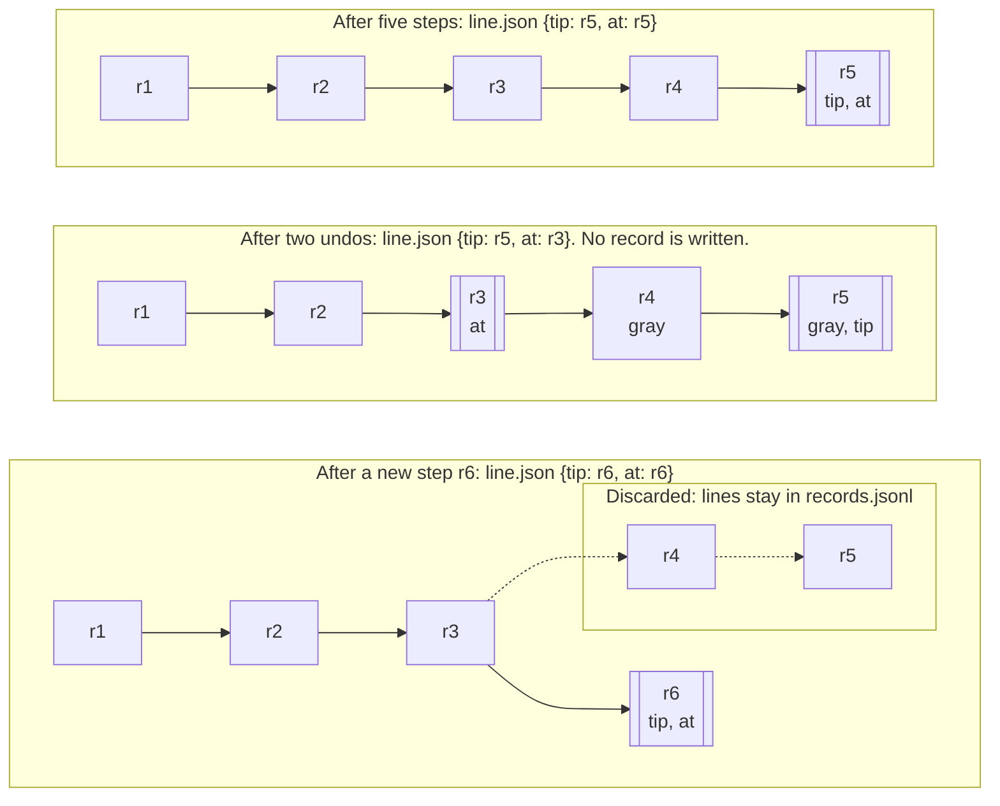
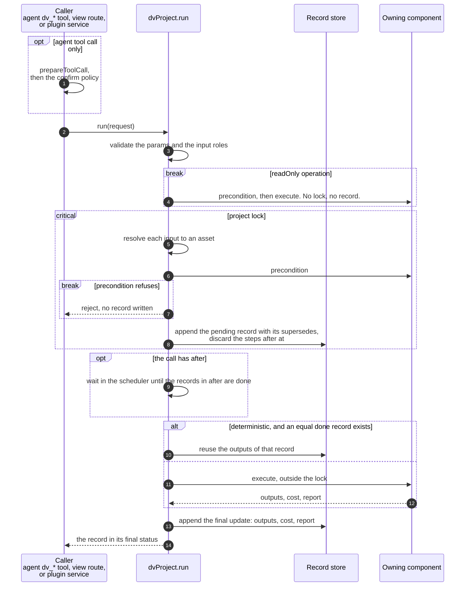
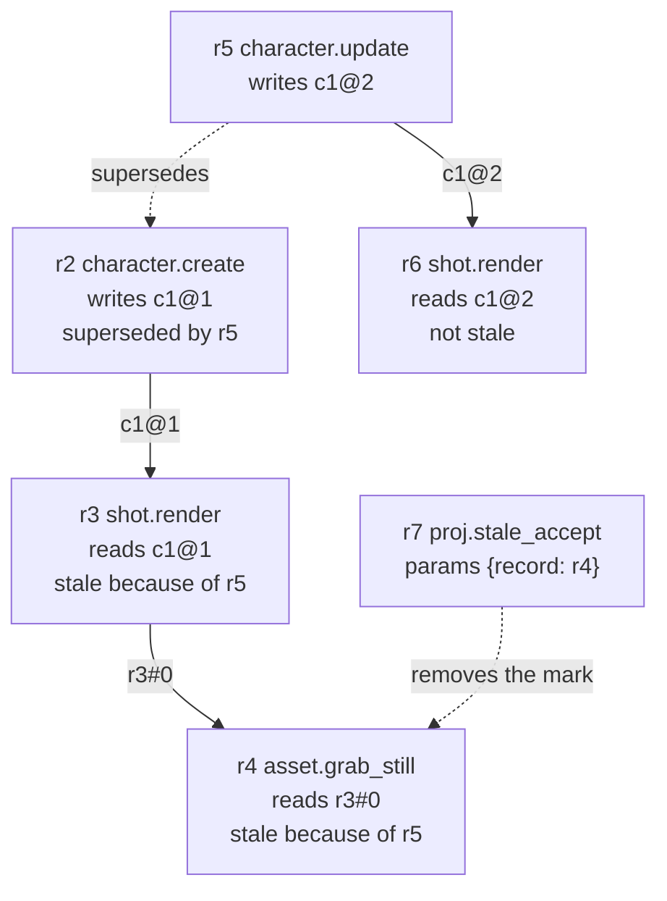

# 项目

[English](project.md) | 中文

`@dv/project` 提供 Cordis 服务 `dvProject`，它是 DreamVerse 的内核。内核负责记录日志、历史列表、操作运行器及其调度器、陈旧标记，以及每个操作的 agent（智能体）工具。内核不提任何插件。插件向内核注册自己的组件键、归约函数、引用种类和操作。[数据流 Agent Note](../../../.agents/notes/implemented/architecture/2026-10-17-dv-architecture-data-flow.zh.md) 给出这一设计的理由。[包 README](../../../packages/dv/project/README.zh.md) 包含配置、方法和模型看到的文本。[`CONTRACTS.md`](../../../packages/dv/project/CONTRACTS.md) 规定每个内部模块。以下包使用 `dvProject`：

- 组件插件 [`@dv/asset-pool`](../../../packages/dv/asset-pool/README.zh.md)、[`@dv/inspector`](../../../packages/dv/inspector/README.zh.md)、[`@dv/shot-plan`](../../../packages/dv/shot-plan/README.zh.md)、[`@dv/timeline`](../../../packages/dv/timeline/README.zh.md) 和 [`@dv/workflow-story`](../../../packages/dv/workflow-story/README.zh.md)。
- [`@dv/generation`](../../../packages/dv/generation/README.zh.md) 构建的插件（`@dv/shot-render`），以及 [`@dv/reference-kit`](../../../packages/dv/reference-kit/README.zh.md) 构建的插件（`@dv/character`、`@dv/location` 和 `@dv/style`）。
- 接口包 [`@dv/api`](../../../packages/dv/api/README.zh.md) 和 [`@dv/chat-references`](../../../packages/dv/chat-references/README.zh.md)。

## 操作记录

项目的每次变化都是项目的 `records.jsonl` 文件中的一条记录。只有 `@dv/project` 读写这个文件。每条记录都有 `kind: 'operation'`，是一个操作的一次调用。一条记录包含以下字段：

- `actor` 说明谁发起调用。值为 `user`、`agent` 或 `system`。
- `surface` 说明调用来自哪里。值为 `chat`、`canvas`、`timeline`、`asset_pool`、`history` 或 `api`。
- `intent` 说明原因。值为 agent 的 `reason` 参数，或对人的手势的简短描述。
- `component`、`operation` 和 `operation_version` 指出所属组件、操作和操作的版本。
- `params` 包含参数。`inputs` 包含各输入，每个输入带有它解析到的素材（`resolved_asset`）。
- `outputs`、`status` 和 `parents` 包含输出、状态和父记录。
- `based_on` 指出本记录带修改地重复的那条记录，例如改了提示词的版本（take）。
- `supersedes` 指出本记录替代其输出的那些记录。
- `session`、`turn` 和 `tool_call` 把记录链接到产生该记录的对话的 DSH 会话日志。它们包含对话 ID、该会话的 DSH 轮次编号和工具调用 ID。

对话本身留在会话日志中。记录存储追加记录，从不改写记录。记录存储把状态变化、成本和报告作为更新行追加。每条记录的父记录是记录存储追加它时项目的当前位置（[历史规则](#history-rules)）。项目组件自己的动作也是记录，例如 `proj.create` 和 `proj.stale_accept`。撤销、重做和移到某一步不写记录。读取也不写记录，例如 `dv_proj_state`、`dv_proj_history_list` 和 `inspect.*` 操作。

## 记录日志

每个项目是一个目录 `<root>/<ProjectId>/`，其中 `<root>` 是 `dvProject` 的 `root` 设置。记录存储模块 `record-store.ts` 是读写该目录中三个文件的唯一代码：

| 文件            | 内容                                                                       | 如何变化                                                         |
| --------------- | -------------------------------------------------------------------------- | ---------------------------------------------------------------- |
| `project.json`  | `ProjectInfo`：项目 `id`、`title` 和 `created_at`                          | 重命名时先写一个临时文件，再把它改名到原位                       |
| `records.jsonl` | 每条记录一个记录行；记录之后的每次变化一个更新行 `{"update": <record>, …}` | 只追加；行的顺序就是写入的顺序                                   |
| `line.json`     | `{tip, at}`（[历史规则](#history-rules)）                                  | 每次追加和每次移动都原子地重写它；没有记录的项目没有 `line.json` |

更新行只设置追加之后会变化的字段：`status`、`started_at`、`finished_at`、`outputs`、`error`、`cost` 和 `report`。`status` 只向前移动。它从 `pending` 变为 `running`，再变为 `done`、`failed` 或 `cancelled`。`pending` 状态也可以直接变为后三者之一。每个模块和每个归约函数都读取记录的当前形式。当前形式是记录行按顺序应用其每个更新行的结果。一个输入可以指向一条未完成记录的输出。在当前形式中，这个输入在生产者记录 `done` 时得到它的 `resolved_asset`。记录存储从不把这个值写入磁盘。

## 历史规则

这些规则说明哪些修改是步骤。这些规则也说明撤销、重做和"回到某一步"做什么。这些规则适用于用户、agent 和系统。这个模型和图片编辑软件的历史面板相同。

1. **修改项目内容是一步。**
   - 项目内容是素材、画布上的素材、角色、场景、风格、分镜计划、渲染、时间线和导出。
   - 用户的步骤和 agent 的步骤在同一个历史列表中，按时间顺序排列。
   - 修改视图不是一步。视图是平移、缩放、节点位置、选中项、所显示的视图和打开的面板。
   - 修改项目名称不是一步。删除项目不是一步。
2. **撤销、重做和"回到某一步"移动当前位置。**
   - 当前位置是历史列表中的一步。项目显示这一步的状态。
   - 撤销把当前位置往回移一步。Ctrl+Z、撤销按钮和 `dv_proj_undo` 执行撤销。
   - 重做把当前位置往前移一步。Shift+Ctrl+Z、重做按钮和 `dv_proj_redo` 执行重做。
   - "回到某一步"把当前位置移到所选的那一步。历史行 ⋮ 菜单中的 回到这一步 执行这个操作。带 `to` 的 `dv_proj_undo` 也执行这个操作。
   - 这些移动不在历史列表中加一步。
3. **在当前位置之后加一步，会丢弃后面的步骤。**
   - 如果当前位置不是最后一步，历史面板把后面的步骤显示为灰色。
   - 如果这时你或 agent 加了一步，历史列表丢弃后面的步骤。
   - 被丢弃的步骤不能找回。
   - 如果被丢弃的步骤没有完成，系统取消它。例如，渲染停止。
4. **导入的素材一直保留；生成的素材跟随当前位置。**
   - 导入的素材是某一步导入的素材。导入的素材留在素材库中，它的那一步被丢弃时也一样。
   - 生成的素材是某一步生成的素材，例如渲染、静帧或导出。只有当它的那一步在当前位置或之前时，素材库才显示这个生成的素材。
   - 所有素材的文件都留在磁盘上。

`@dv/project` 实现这些规则。每个项目有一个 `line.json` 文件，内容是 `{tip, at}`。`tip` 是最后一步，历史列表是 `tip` 的 `parents[0]` 祖先链。`at` 是当前位置。撤销、重做和移到某一步改变 `at`，不写记录。一次写入把它的记录追加在 `at` 之后，并把 `tip` 和 `at` 都设为这条记录。因此原来在 `at` 之后的步骤离开历史列表，它们的行仍留在 `records.jsonl` 中。运行器取消其中每个尚未结束的步骤，错误为 `error.code: 'discarded'`。`dvProject` 的三个方法移动 `at`，每个方法都拒绝某些移动：

- `dvProject.undo` 以 `nothing_to_undo` 拒绝从第一条记录再往回移。
- `dvProject.redo` 以 `nothing_to_redo` 拒绝从最后一步再往前移。
- `dvProject.moveTo` 以 `unknown_record` 拒绝未知的记录，以 `invalid_params` 拒绝被丢弃的记录。

下图显示一个项目的历史列表的三种状态。名字 `r1` 到 `r6` 代表记录 ID。

## 组件

组件键指一个插件所拥有的项目部分：它的操作、它的记录和它的状态切片。内核只注册自己的键 `proj`，不保存其他键的列表。插件先注册自己的键，再注册归约函数、引用种类和操作。插件在 `ctx.effect` 中进行每项注册，因此插件被释放时会移除这项注册。`dvProject` 的每个注册方法都拒绝违反其规则的注册：

| 方法                            | 注册的内容                                    | 拒绝时的错误                                                                                                                                        |
| ------------------------------- | --------------------------------------------- | --------------------------------------------------------------------------------------------------------------------------------------------------- |
| `registerComponent(key)`        | 一个组件键                                    | 已注册的键：`component_exists`                                                                                                                      |
| `registerReducer(key, reducer)` | 该键的状态切片的归约函数                      | 未注册的键：`invalid_params`；同一个键的第二个归约函数：`reducer_exists`                                                                            |
| `registerReferenceKind(spec)`   | 一个引用种类（[输入引用](#input-references)） | 未注册的组件和种类 `asset`、`record`、`version`：`invalid_params`；同一种类的第二个所有者：`kind_exists`                                            |
| `registerOperation(spec)`       | 一个操作及其 agent 工具                       | 已注册的名字：`operation_exists`；未注册的组件、不以 `<component>.` 开头的名字，或 `confirm` 不为 `never` 却没有 `confirmSummary`：`invalid_params` |

一个键可以没有归约函数。

## 操作

操作名的形式是 `<key>.<verb>` 或 `<key>.<object>_<verb>`，其中 `<key>` 是所属组件键。例如 `asset.import` 和 `timeline.clip_move`。操作的 agent 工具名是 `dv_` 加上把每个点换成 `_` 的操作名，例如 `dv_timeline_clip_move`。一个插件只运行自己的操作。其他插件通过所属插件的类型化 Cordis 服务使用这些操作。例如，`dvTimeline.layout` 运行 `timeline.create` 或 `timeline.update`。

`packages/dv/project/src/operation-types.ts` 中的一个 `OperationSpec` 声明一个操作。它的 JSDoc 定义每个成员。内核和其他包在以下位置读取这些成员：

| 成员                                                       | 读取方                                                                                                                          |
| ---------------------------------------------------------- | ------------------------------------------------------------------------------------------------------------------------------- |
| `name`、`component`、`version`                             | 运行器，它把这些值作为 `operation`、`component` 和 `operation_version` 写入记录                                                 |
| `description`、`params`、`toolParams`、`inputs`、`outputs` | agent 工具和画布表单；运行器校验 `params`，并拒绝 `inputs` 未声明的输入角色                                                     |
| `label`                                                    | `@dv/api` 中的 `toWireOperation`，它在 `GET /api/dv/operations` 中发送这个值；以及 `@dv/ui-kit` 中的 `operationLabel`           |
| `prepareToolCall`、`confirm`、`confirmSummary`、`estimate` | agent 工具，在它调用 `dvProject.run` 之前（[在对话中确认](#confirmation-in-the-conversation)）                                  |
| `precondition`、`supersedes`                               | 运行器，在项目锁内（[操作如何运行](#how-an-operation-runs)）                                                                    |
| `pendingInputRoles`                                        | 运行器和调度器（[输入引用](#input-references)）                                                                                 |
| `deterministic`                                            | 运行器（[确定性复用](#deterministic-reuse)）                                                                                    |
| `resource`                                                 | 调度器，它按[并发设置](../../../packages/dv/project/README.zh.md#use-this-package)限制 `gpu` 和 `cpu` 调用；`none` 调用不受限制 |
| `readOnly`                                                 | 运行器，对只读操作不写记录，也不取项目锁                                                                                        |
| `summarize`                                                | 聊天卡片、画布节点和项目摘要中的最近记录                                                                                        |
| `execute`                                                  | 运行器，在项目锁之外                                                                                                            |

`label` 是 `{zh, en}`，即视图为该操作显示的名称。内核只存储它。`@dv/ui-kit` 中的 `DV_TOOL_LABELS` 为所在包不声明名称的工具命名：`dv_proj_*`、`dv_asset_*` 和 `dv_models_*` 工具。

`execute` 会运行更多操作的操作，在每个运行请求中传入 `started_by`。`StartedBy` 是 `{record, slot, lane?}`：

- `record` 是其 `execute` 启动这次调用的记录。
- `slot` 是调用方在自己的序列中给这次调用的位置，例如镜头的 slot，或 null。
- `lane` 是调用方的并行序列，例如一个广告变体。

运行器把 `started_by` 复制到它追加的记录上，不检查其中的记录是否存在。内核从不读取这个字段。工作流写入它，`@dv/ui-kit` 中的 `chainOf` 为画布和历史面板读取它。

## 输入引用

运行请求的每个输入是一个角色和一个 `RecordInputRef`。agent 工具和 `@dv/api` 的路由以文本形式接收每个引用。`packages/dv/project/src/agent-tools.ts` 中的 `parseInputRef` 把文本变为引用：

| 文本             | `RecordInputRef`                                                  | 指向                    | 运行器把它解析为                                                         |
| ---------------- | ----------------------------------------------------------------- | ----------------------- | ------------------------------------------------------------------------ |
| `<asset>`        | `{asset}`                                                         | 素材库中的一个素材      | 该素材；素材库没有它时为 `unknown_asset`                                 |
| `<record>#<n>`   | `{record, output}`                                                | 一条记录的第 `n` 个输出 | 该记录 `done` 时的 `outputs[n]`；该记录失败或被取消时为 `invalid_inputs` |
| `<id>@<version>` | 种类键加 ID，再加 `version`，例如 `{character: 'c1', version: 2}` | 一个引用种类的一个版本  | 该版本的每个素材各一个输入，素材来自该种类的 `assetsOf`                  |

`parseInputRef` 把以 `#` 加非负整数结尾的文本读作记录的输出。然后它把以 `@` 加整数结尾的文本读作版本。其他文本都读作素材 ID。对于版本，它询问每个已注册种类的 `createdBy`，看该种类是否有这个版本。没有种类或多于一个种类有这个版本时，`parseInputRef` 抛出 `invalid_inputs`。

`<record>#<n>` 输入可以指向 `pending` 或 `running` 的记录。运行器只在两种情况下接受它。第一种情况是带 `after` 的调用，调度器在其生产者 `done` 时运行它。第二种情况是输入角色在 `OperationSpec.pendingInputRoles` 中。这个输入的 `resolved_asset` 保持为 null，直到生产者 `done`。其他情况下，运行器以 `input_not_ready` 拒绝该调用。

引用种类是一种带版本的元素，例如 `character`。拥有一个种类的插件通过声明合并把该种类加入 `ReferenceKinds`，并注册一个 `ReferenceKindSpec`。这个 spec 包含 `kind`、所属的 `component`，以及读取所有者切片的三个函数：`assetsOf`、`createdBy` 和 `latest`。所有种类共享一个 ID 空间。每个所有者的创建操作拒绝 `kindsWithId` 列出的 ID。注册或移除一个种类会重建每个操作工具，因为每个工具的 `inputs` 文本列出已注册的种类。[引用名词](reference-nouns.zh.md) 描述 `@dv/reference-kit`，它为每个名词注册一个种类。

## 操作如何运行

视图和 agent 到达同样的操作：

- 画布、时间线或素材库面板上的手势通过 `@dv/api` 的路由运行一个操作。路由设置 `actor: 'user'`，并把 `surface` 设为该视图。
- agent 调用该操作的 `dv_*` 工具。工具以 `actor: 'agent'`、`surface: 'chat'`、对话、轮次和工具调用 ID 运行该操作。agent 的调用运行之前，操作的 `prepareToolCall` 可以拒绝或修改这次调用。然后 agent 工具应用该操作的 `confirm` 策略。

每次调用都经过 `dvProject.run` 的运行器。运行器校验参数。在项目锁内，运行器把每个输入解析为素材，并调用操作的 `precondition`。在运行器写入记录之前，precondition 对每个调用方拒绝调用。例如，`shot.render` 和 `story.approve` 拒绝模型的目录条目所拒绝的渲染请求。生成任务 `ref2v` 下没有参考素材的 `fasth3` 渲染就是这样的请求。

precondition 之后，运行器追加 `pending` 记录。运行器把操作的 `supersedes` 函数指出的记录加入该记录的 `supersedes`。最后，运行器在锁外运行所属组件的实现。然后运行器追加带输出、成本和报告的最终更新行。

两类调用在项目组件的调度器中等待，直到其输入完成：

- 输入指向未完成记录的调用；
- 批准计划时排定的每次渲染。

下图显示一次调用的顺序。第 5 到第 8 步在项目锁内运行，因此同一个项目上的两次调用从不同时写入。

## 在对话中确认

agent 在对话中征得用户同意，问题用粗体显示。`OperationSpec.confirm` 声明 agent 的调用何时需要这一同意：

| `confirm`         | 仅工具参数       | agent 工具拒绝 agent 调用的条件                                                                    | 操作            |
| ----------------- | ---------------- | -------------------------------------------------------------------------------------------------- | --------------- |
| `never`           | —                | 从不                                                                                               | 其他所有操作    |
| `always`          | `user_approved`  | 没有带 `user_approved: true`                                                                       | `story.approve` |
| `over_gpu_budget` | `user_requested` | 没有带 `user_requested: true`，且本轮次的 GPU 秒数超过 `dvProject` 的 `confirmGpuSecondsThreshold` | `shot.render`   |

一个轮次的 GPU 秒数是以下三个值之和：

- 该轮次已完成记录的成本；
- 该轮次未完成记录的 `estimate`；
- 本次调用的 GPU 预估。

`confirm` 不为 `never` 的操作提供 `confirmSummary(call, state)`。这个函数返回 `{text, gpu_seconds}`。`text` 说明调用将做什么，`gpu_seconds` 是调用的 GPU 预估。对 `story.approve`，`text` 为每个镜头写一行。这一行写出模型键（`modality/task/provider/model`）、时长、该镜头是否接上一镜头，以及提示词。

拒绝是一个带着这段文字的工具错误。这个错误告诉 agent 展示这段文字，并在对话中用粗体向用户提问。用户同意后，agent 带上该参数重新调用。agent 工具对被拒绝的调用不写入任何东西。agent 工具从参数中移除仅工具参数，因此该参数从不进入记录。agent 工具从不拒绝人或系统的调用。

## 项目状态

归约函数读取记录并计算状态。归约函数不写记录。运行器和记录存储是仅有的写入者。项目组件从以当前位置结尾的记录链计算当前状态。项目组件从这条记录沿 `parents[0]` 往回走。然后项目组件把这些记录按从旧到新的顺序交给每个已注册的归约函数。每个组件的归约函数把该组件的记录变成 `ProjectState.components` 中该组件的切片：

| 组件       | 切片        |
| ---------- | ----------- |
| 素材库     | `asset`     |
| 角色       | `character` |
| 场景       | `location`  |
| 风格       | `style`     |
| 分镜计划   | `plan`      |
| 时间线     | `timeline`  |
| 故事工作流 | `story`     |

项目组件自己的归约函数维护 `proj` 切片。这个切片包含这条链上的记录、陈旧和被替代的记录，以及创建每个素材的记录。归约函数的 `agentSummary` 把其组件的字段加入项目摘要。`dv_proj_*` 工具和 `dv:project` 提示词段把项目摘要交给 agent。

归约函数按注册顺序看到每条记录。`ReducerRegistry.reduceChain` 把一条记录传给每个归约函数，然后才处理下一条记录。归约函数是纯函数。它接收每个组件的记录，并忽略它不解释的记录。插件通过声明合并到 `ComponentStates` 来声明自己切片的类型（[客户端状态类型](../../../.agents/notes/implemented/architecture/2026-10-17-dv-architecture-client-state-types.zh.md)）。

视图显示的要么是记录，要么是状态：

- 历史面板显示记录。面板列出历史列表中的步骤，最新的在前。面板不显示被丢弃的记录。
- 画布、时间线编辑器和素材库面板显示当前状态。撤销、重做或移到某一步会改变这些视图画出的内容。
- 素材库面板列出当前状态中的每个素材。面板也列出项目中每个导入的素材，包括被丢弃的步骤导入的素材（[历史规则](#history-rules)第 4 条）。

## 项目摘要和协议状态

agent 和视图以两种形式读取当前状态：

- **项目摘要。** `packages/dv/project/src/proj-tools.ts` 中的 `projectSummary` 构建它。写入工具的摘要以 `record` 开始，即这次工具调用写入的最新记录。然后每份摘要都包含 `project_id`、`head` 和记录数。接着是每个归约函数的 `agentSummary` 字段，`proj` 在前，其他组件键按字母顺序排在其后。最后是 `stale` 和最近的 12 条记录。两个归约函数使用同一个字段名时抛出 `invalid_params`。除 `dv_proj_history_list` 外，每个 `dv_proj_*` 工具都返回这份摘要。[包 README](../../../packages/dv/project/README.zh.md#model-experience) 列出模型看到的字段。
- **协议状态。** `packages/dv/api/src/wire.ts` 中的 `toWireState` 构建 `GET /api/dv/state` 返回的 `WireState`。它包含 `project`、`head`（当前位置 `at`）、`tip`、原样的切片和 `assets`。`assets` 列出视图所见的项目素材（[素材](assets.zh.md#imported-and-generated-assets)）。

没有视图持有项目状态。每个视图获取协议状态，并在实时事件流的事件之后重新获取。`dvProject.subscribe` 为 `/dv/events` 的实时事件流提供数据。`@dv/ui-kit` 中的 `useProjectState` 在一阵事件的最后一个事件之后 150 ms 重新获取协议状态。

## 陈旧状态

项目组件的归约函数标记陈旧记录，不重跑任何东西。当一条之后的记录在 `supersedes` 中列出记录 X 时，X 被替代。以下规则决定哪些记录陈旧：

- 读取的输入的生产者已被替代的记录是陈旧的。
- 读取的输入的生产者已陈旧的记录也是陈旧的。因此标记到达被替代记录下游的每条记录。
- 输入的生产者是创建该输入素材的记录。对角色、场景或风格的版本，生产者是写入该版本的记录。

所属操作通过 `OperationSpec.supersedes` 决定一次调用替代哪些记录。`character.update`、`location.update` 和 `style.update` 替代创建上一版本的记录。因此读取了上一版本的每条记录都是陈旧的。调用方也可以在 `supersedes` 中指定记录。agent 为替换某个镜头的重拍这样做。

只有 agent 或人决定重跑陈旧记录。`proj.stale_accept` 清除一条记录的标记。此后，该记录的消费者不会因它而变为陈旧。

下图显示一个项目中的陈旧状态。名字 `r2` 到 `r7` 代表记录 ID。实线箭头表示哪条记录读取另一条记录写下的输出或版本。虚线箭头表示一条记录替代哪条记录，以及 `proj.stale_accept` 清除哪条记录的标记。

## 确定性复用

对 `deterministic: true` 的操作的一次调用，运行器可以复用一条更早的 `done` 记录。那条更早的记录必须有相同的操作和版本、相等的参数和相同的已解析输入素材。运行器这时复制那条更早记录的输出，不运行该操作。运行器仍为这次调用追加一条记录，并带 `cost.reused: true`。渲染不是确定性的（[渲染与版本](shots-and-timeline.zh.md#renders-and-takes)）。
