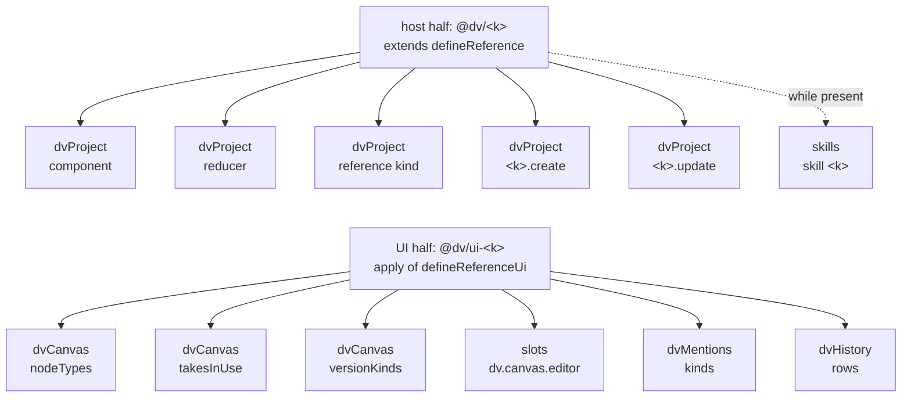

# Reference nouns

English | [中文](reference-nouns.zh.md)

This page is the reference for the DreamVerse reference nouns and the reference kit that they share. The nouns are character, location and style. The host packages [`@dv/character`](../../../packages/dv/character/README.md), [`@dv/location`](../../../packages/dv/location/README.md) and [`@dv/style`](../../../packages/dv/style/README.md) provide the services `dvCharacter`, `dvLocation` and `dvStyle`, and each service is one declaration on [`@dv/reference-kit`](../../../packages/dv/reference-kit/README.md). The UI packages [`@dv/ui-character`](../../../packages/dv/ui-character/README.md), [`@dv/ui-location`](../../../packages/dv/ui-location/README.md) and [`@dv/ui-style`](../../../packages/dv/ui-style/README.md) show the nouns in the views, and each one is one declaration on the file `packages/dv/ui-kit/src/client/reference-kit.tsx` of [`@dv/ui-kit`](../../../packages/dv/ui-kit/README.md). The runner of `@dv/project`, `@dv/chat-references`, `@dv/api`, `@dv/ui-canvas`, `@dv/ui-composer` and `@dv/ui-history` use the nouns through what the kit registers. [Adding a reference noun](../cookbook/adding-a-reference-noun.md) gives the steps to add a noun, and the [reference-nouns Agent Note](../../../.agents/notes/implemented/architecture/2026-10-17-dv-architecture-reference-nouns.md) gives the reasons for this design.

## A reference noun

A reference noun is a component whose items have the following shape, called the kit shape:

- Each item has an ID and a list of versions. Every create or update writes the next version and keeps the earlier versions.
- Each version stands for a list of reference images (`references`, asset IDs). A version also has a name and a description.
- An input names one version as `<id>@<version>`, such as `c1@3`. The runner resolves the input to the reference images of that version.
- An update supersedes the record that wrote the previous version. [Staleness](project.md#staleness) in Project describes which records then become stale.

One key names every part of a noun. These parts are the component key, the reference kind, the ID param, the operation prefix, the skill name and the canvas node type. For example, the key `character` names the slice `components.character`, the param `character` of `character.create`, the skill `character` and the node ID `character:c1`.

The slice of a noun has the type `ReferenceSlice<V>`. It maps each ID to its versions, oldest first. A version has the type `ReferenceVersion<I>` with the fields `id`, `version`, `name`, `description`, `references` and `created_by`, the record that wrote the version. `version` is 1 for the version that `<k>.create` writes, and one more for each `<k>.update`.

| Noun      | Key         | Host package (service)            | UI package         | `@` menu section and order |
| --------- | ----------- | --------------------------------- | ------------------ | -------------------------- |
| character | `character` | `@dv/character` (`dvCharacter`)   | `@dv/ui-character` | 角色 / Characters, 1       |
| location  | `location`  | `@dv/location` (`dvLocation`)     | `@dv/ui-location`  | 场景 / Locations, 2        |
| style     | `style`     | `@dv/style` (`dvStyle`)           | `@dv/ui-style`     | 风格 / Styles, 3           |

## The two halves of the reference kit

The reference kit implements the kit shape once, in two halves. The host half is the package `@dv/reference-kit` with `defineReference`. The UI half is the file `packages/dv/ui-kit/src/client/reference-kit.tsx` with `defineReferenceUi` and `ReferenceEditor`, which a UI package imports as `@dv/ui-kit/reference-kit.tsx`. Each noun package makes one call to its half and fills in only what differs between nouns. The diagram shows the two calls of a noun `<k>` and what each call registers.

## The host declaration: `defineReference`

`defineReference(spec)` returns a Cordis service class. The host package default-exports a subclass of that class, as `class DvCharacter extends defineReference({...}) {}` in `packages/dv/character/src/index.ts` does. The declaration has these fields:

- `service`: the Cordis service name, such as `dvCharacter`.
- `component`: the key of the noun.
- `noun`: the noun words `{ zh, en }` of the operation labels, such as 新建角色 / Create character.
- `meaning`: what one item is, in the description of `<k>.create`.
- `reference`: the input roles of both operations. The kit names no media type, so the declaration gives the `image` type of each role.
- `skill`: the `description` and `whenToUse` text of the skill, and the `file` URL of its body.
- `fields`: optional extra version fields. Each field is one param of both operations and has an initial value for a new ID.

The service class injects `dvProject`. Its constructor registers the component key, the reducer, the reference kind, the two operations and the skill, as the diagram shows. The constructor registers the skill only while the DSH skill registry `skills` is present. The reducer `referenceReducer(spec)` reads only the finished `<k>.create` and `<k>.update` records. Its agent summary gives the field `<k>s` with the newest version of each ID. The reference kind reads the slice through these methods:

- `assetsOf` gives the reference images of a version.
- `createdBy` gives the record that wrote a version.
- `latest` gives the newest version of an ID.

`<k>.create` writes version 1 of an ID. It refuses an empty ID and an ID that contains `@` or `#`. It also refuses an ID that `dvProject.kindsWithId` lists, so an ID is unique across all reference kinds. `<k>.update` writes the next version of an ID and refuses an unknown ID. An update keeps each param that it leaves out, and an update without inputs keeps the previous reference images. The [`@dv/reference-kit` README](../../../packages/dv/reference-kit/README.md) lists the params of both operations and the text that the model sees.

The client face `@dv/reference-kit/types` exports `ReferenceVersion`, `ReferenceSlice` and `ReferenceKey`. A declaration compiles only with a key of type `ReferenceKey`. For this type, the host package must merge the key into both `ComponentStates` and `ReferenceKinds` of `@dv/project/types`, with a `ReferenceSlice` value. The fitness rules R2 and R3 also apply to the kit and to each `defineReference` key. The Rules section of [DreamVerse architecture checks](../architecture-checks.md) states both rules.

## The UI declaration: `defineReferenceUi`

`defineReferenceUi(spec)` returns the descriptors of one noun and `apply(ctx)`, the client plugin body that registers them. The UI package exports `apply = <k>.apply`. The declaration has these fields:

- `id`: the package name, such as `@dv/ui-character`. It is the ID of each descriptor and the key of the editor entry.
- `key`: the key of the noun.
- `slice`: a function that returns the slice of the noun from the wire state. The slice is `undefined` while the host package is not loaded, and the descriptors then list no items.
- `label`: the card label and the picker section, such as 角色 / Character.
- `mention`: the `@` menu section and its order.
- `editor`: an optional editor body. The default is `ReferenceEditor`.

A UI package imports its host package only with `import type`, so it cannot read `noun` at runtime. The UI declaration therefore repeats the label pair of the host declaration.

`apply(ctx)` registers each descriptor while the service of its registry is present. `dvCanvas` comes from `@dv/ui-canvas`, which also declares the slot `dv.canvas.editor`. `dvMentions` comes from `@dv/ui-composer`, and `dvHistory` comes from `@dv/ui-history`. The node type draws one entry `<k>:<id>` for each item at its newest version. The references in use are the records that made the newest reference images. The mention kind lists the items as `dv:<k>/<id>`. The History row matches the records of `<k>.` and names the item by the `name` param of the record, or else by its ID.

`ReferenceEditor` is the default editor body. It shows the reference images, the description, the rows of `children`, and the button ＋ 添加素材 / + Add asset. Each change runs `<k>.update` through `host.run` with the input role `reference`. The editor disables the remove button while a version has only one reference image.

## Extension points

The kit has four extension points. A noun package uses them to add behavior to its noun:

- `fields` of the host declaration: extra version fields. Each field is one param of both operations.
- `children` of `ReferenceEditor`: extra form rows. An `editor` body that wraps `ReferenceEditor` passes them. Each row writes through `update`, which runs `<k>.update` with its params and no inputs.
- `editor` of the UI declaration: a whole editor body in place of `ReferenceEditor`.
- More `<k>.*` operations: the service class of the noun registers them in its own constructor, because the class extends the class that `defineReference` returns.

## Who imports the kit

Only the six noun packages import the kit in `src`. The three host packages import `@dv/reference-kit`, and the three UI packages import `@dv/ui-kit/reference-kit.tsx`. Every other plugin reads the nouns through what the kit registers:

- The runner of `@dv/project` resolves `c1@3` through the registered reference kind.
- `@dv/chat-references` expands `dv:<kind>/<id>` for each kind in `dvProject.listReferenceKinds()`.
- `@dv/api` collects the reference images of the versions from the resolved inputs of the records (`mentionedAssets`).
- `@dv/ui-canvas`, `@dv/ui-composer` and `@dv/ui-history` draw the nouns from the `dvCanvas`, `dvMentions` and `dvHistory` registries.

A component of another shape, such as `@dv/shot-plan` or `@dv/timeline`, calls `dvProject.registerComponent`, `registerReducer` and `registerOperation` itself. `packages/dv/COMPONENT-TEMPLATE.md` shows these calls and `registerReferenceKind`.

## Kit membership

A noun uses the kit only while its items have the kit shape. The kit follows these rules:

- **No option for one noun.** The kit adds no option, branch, default or token that only one noun uses. A noun package adds behavior only through the four extension points.
- **Direct registration.** A noun can need a different version shape, different create or update semantics, or a different result of `<id>@<version>`. Then its two packages stop using the kit and register with `dvProject` and the client registries directly. This change edits only those two packages, because every other plugin reads nouns through the registries.
- **Two nouns or none.** The kit keeps at least two nouns. When only one noun uses the kit, the code of the kit moves into the two packages of that noun.

Code review enforces these rules. No automated check enforces them. The [reference-nouns Agent Note](../../../.agents/notes/implemented/architecture/2026-10-17-dv-architecture-reference-nouns.md) gives the reasons for them.

| A noun needs                                                          | Mechanism                                                      | Uses the kit     |
| --------------------------------------------------------------------- | -------------------------------------------------------------- | ---------------- |
| More version fields and form rows                                     | `fields`, `children`                                           | yes              |
| A different editor, such as a character portrait panel                | `editor`                                                       | yes              |
| More operations, such as training a LoRA or checking face consistency | the constructor of the service class of the noun               | yes              |
| A different version meaning, or a different `<id>@<version>` result   | direct registration with `dvProject` and the client registries | no               |
