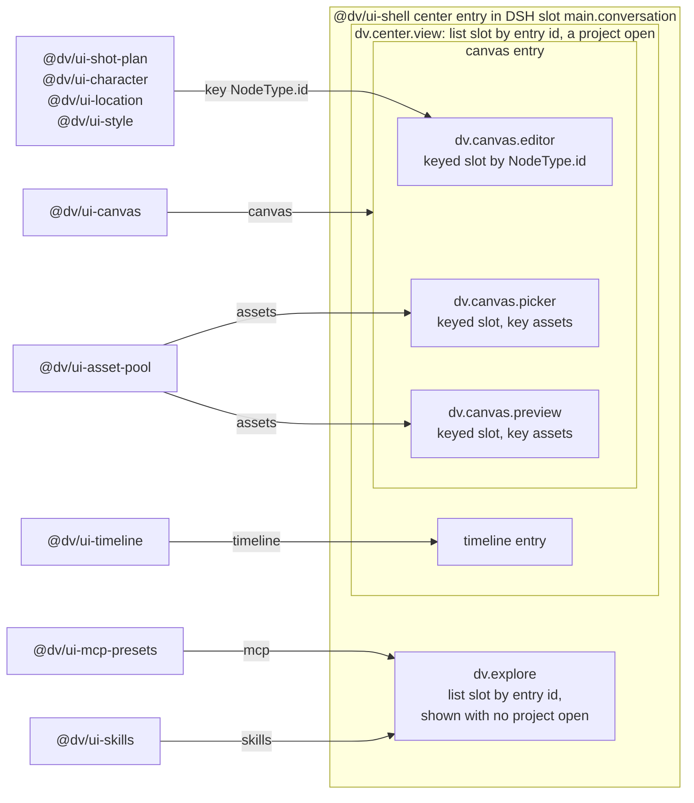

# User interface

English | [中文](ui.zh.md)

The DreamVerse browser code is UI core and UI plugins. UI core is five packages: `@dv/ui-kit`, `@dv/ui-canvas`, `@dv/ui-history`, `@dv/ui-shell`, and `@dv/ui-composer`. Three UI-core packages provide one client service each: `@dv/ui-canvas` provides `dvCanvas`, `@dv/ui-history` provides `dvHistory`, and `@dv/ui-composer` provides `dvMentions`. The ten UI plugins register descriptors into these services and entries into the slots of UI core. `@dv/ui-shell` declares the slots of the workspace center, and `@dv/ui-canvas` declares the slots of the canvas editors. Every UI package reads a project through the `@dv/api` routes ([Agent and API](agent-and-api.md)) and changes it only by running an operation. The [UI registries note](../../../.agents/notes/implemented/architecture/2026-10-17-dv-architecture-ui-registries.md) and the [client state types note](../../../.agents/notes/implemented/architecture/2026-10-17-dv-architecture-client-state-types.md) give the reasons for this design.

## UI core and UI plugins

UI core draws the data of a plugin only through the descriptors and the slot entries that the plugin registers. A UI plugin is a package `packages/dv/ui-<name>` with a `./client` entry. When a host package `@dv/<name>` exists, the UI plugin is the browser half of that package. The [architecture page](../architecture.md) gives the allowed imports of each layer.

Each UI-core package owns these parts:

| Package                                                         | Owns                                                                                                                                                                                                                                                                                                                                                                                                                                                                           |
| --------------------------------------------------------------- | ------------------------------------------------------------------------------------------------------------------------------------------------------------------------------------------------------------------------------------------------------------------------------------------------------------------------------------------------------------------------------------------------------------------------------------------------------------------------------ |
| [`@dv/ui-kit`](../../../packages/dv/ui-kit/README.md)           | A library with no plugin entry. It registers nothing, and each consumer bundles the modules that it imports. It holds the wire types (`types.ts`), the descriptor types and `createRegistry` (`registries.ts`), `defineReferenceUi` (`reference-kit.tsx`), the `/api/dv` client (`api.ts`), and the helpers that every view applies in one way: `chainOf`, `versionRefOf`, `formatInputRef`, `isGenerationOperation`, `isGenerationRecord`, `operationLabel`, and `taskLabel`. |
| [`@dv/ui-canvas`](../../../packages/dv/ui-canvas/README.md)     | The `dvCanvas` service, the `dv-canvas` right-Sidebar tab type, and the `canvas` center view. The center view declares the slots `dv.canvas.editor`, `dv.canvas.picker`, and `dv.canvas.preview`, and gives each editor entry an `EntryEditorHost`.                                                                                                                                                                                                                            |
| [`@dv/ui-history`](../../../packages/dv/ui-history/README.md)   | The `dvHistory` service and the `dv-history` tab type (the History panel). A `dv:history-focus` event opens the tab.                                                                                                                                                                                                                                                                                                                                                           |
| [`@dv/ui-shell`](../../../packages/dv/ui-shell/README.md)       | The workspace center in place of the DSH `main.conversation` entry, with the slots `dv.explore` and `dv.center.view`; the left-sidebar navigator; the theme; the 对话 / Chat and 轨迹 / Trajectory tab types; the undo and redo keys; and the `dv:trajectory-focus` link.                                                                                                                                                                                                          |
| [`@dv/ui-composer`](../../../packages/dv/ui-composer/README.md) | The `dvMentions` service and the additions to the chat composer: the `@` source, the 引用 / Reference row of the ＋ menu, the creator-facing tool names, the media cards in chat Markdown, the 在历史中查看 / Show in history link, and the `dv:compose` prefill.                                                                                                                                                                                                                       |

Each UI plugin registers these parts:

| Package                                                                     | Host package         | Registers                                                                                                                                   |
| --------------------------------------------------------------------------- | -------------------- | ------------------------------------------------------------------------------------------------------------------------------------------- |
| [`@dv/ui-asset-pool`](../../../packages/dv/ui-asset-pool/README.md)         | `@dv/asset-pool`     | The `dv-asset-pool` tab type, and the `dv.canvas.picker` and `dv.canvas.preview` entries at key `assets`                                    |
| [`@dv/ui-character`](../../../packages/dv/ui-character/README.md)           | `@dv/character`      | One `defineReferenceUi` call: a node type, a version kind, takes in use, a mention kind, a history row, and a `dv.canvas.editor` entry      |
| [`@dv/ui-location`](../../../packages/dv/ui-location/README.md)             | `@dv/location`       | One `defineReferenceUi` call: a node type, a version kind, takes in use, a mention kind, a history row, and a `dv.canvas.editor` entry      |
| [`@dv/ui-style`](../../../packages/dv/ui-style/README.md)                   | `@dv/style`          | One `defineReferenceUi` call: a node type, a version kind, takes in use, a mention kind, a history row, and a `dv.canvas.editor` entry      |
| [`@dv/ui-shot-plan`](../../../packages/dv/ui-shot-plan/README.md)           | `@dv/shot-plan`      | The node type `plan`, takes in use, a history row, and the plan editor as a `dv.canvas.editor` entry                                        |
| [`@dv/ui-shot-render`](../../../packages/dv/ui-shot-render/README.md)       | `@dv/shot-render`    | The render card of `dv_shot_render` in the DSH `tool.call.toolview` slot                                                                    |
| [`@dv/ui-timeline`](../../../packages/dv/ui-timeline/README.md)             | `@dv/timeline`       | The `dv-timeline` tab type, the `timeline` center view, takes in use, a history row, and the mention kind `clip`                            |
| [`@dv/ui-workflow-story`](../../../packages/dv/ui-workflow-story/README.md) | `@dv/workflow-story` | The chain anchor of `story.approve` and its history row                                                                                     |
| [`@dv/ui-mcp-presets`](../../../packages/dv/ui-mcp-presets/README.md)       | `@dv/mcp-presets`    | The `mcp` entry of `dv.explore`: the MCP tab of the 探索 / Explore section                                                                  |
| [`@dv/ui-skills`](../../../packages/dv/ui-skills/README.md)                 | none                 | The `skills` entry of `dv.explore`, the 技能 / Skills entry of the DSH `sidebar.panellist` slot, and the Skills page in the DSH `main` slot |

## The views

The UI packages are right-Sidebar tab types and center views of the web application. So the views and the chat page show in one profile. Each package draws these parts:

- [`@dv/ui-shell`](../../../packages/dv/ui-shell/README.md) puts the project workspace in the center and the 对话 / Chat and 轨迹 / Trajectory tabs on the right. It puts the 画布 / Canvas and 时间线 / Timeline toggle in the top bar. It binds the undo and redo keys of the [history rules](project.md#history-rules).
- [`@dv/ui-canvas`](../../../packages/dv/ui-canvas/README.md) draws the current state as nodes linked by asset flow. It marks stale records. Its node editor writes a user record when it renders a new take or replaces a reference image.
- [`@dv/ui-timeline`](../../../packages/dv/ui-timeline/README.md) draws each timeline as one track. It turns insert, move, remove, split, and trim gestures into `timeline.*` records that name clips by `ClipId`. It turns an export into a `timeline.export` record.
- `@dv/ui-asset-pool` lists every asset of the project and imports files.
- `@dv/ui-composer` adds the `@` and `+ → 引用` references and the creator-facing tool names to the chat.
- `@dv/ui-shot-render` adds the render card of `dv_shot_render` to the chat.

The canvas draws these nodes:

- the imported assets;
- the takes, each with its model and task;
- the characters, locations, and styles at their current version, from `@dv/ui-character`, `@dv/ui-location`, and `@dv/ui-style`;
- each plan at its latest version, from `@dv/ui-shot-plan`, with the model and task of each shot. A shot that sets 接上一镜头 / Continues the previous shot also shows it.

`@dv/ui-workflow-story` links the takes of a story approval to the plan node ([chains and anchors](#canvas-history-mention-rules)).

## Slots of the shell and the canvas

A slot is a named place of the DSH client that plugins fill with entries through `ctx.slots`. Exactly one entry declares each DreamVerse slot. The `@dv/ui-shell` center entry declares `dv.explore` and `dv.center.view`. The `canvas` entry of `dv.center.view` declares the three canvas slots. The `dv-canvas` tab body (`CanvasBody.tsx`) declares no slot, so the canvas slots render only in the center view.

The shell shows the entries of `dv.center.view` as the toggle of the top bar, in `order`. A URL view that no entry has shows the first entry. The editor of a canvas node renders the `dv.canvas.editor` entry whose key is the `NodeType.id` of the node. An editor entry imports only `@dv/ui-kit`, so the canvas gives it an `EntryEditorHost` with three callbacks:

- `run` runs an operation as a canvas write, with the project and the chat session of the canvas.
- `pickAssets` opens the asset picker of the canvas.
- `preview` opens the asset preview of the canvas.

## Registries

A registry is a list of descriptors that UI plugins add and remove. Each registry is a client service. The UI-core package that reads the registry provides it with `ctx.reflect.provide` at the top level of its `apply`. The provider does not do this inside an effect, because other plugins register into the registry from their own fibers. A fiber is the Cordis lifecycle unit of one loaded plugin.

`createRegistry(keys)` in `@dv/ui-kit/registries.ts` makes an empty registry. The `keys` function gives the keys of one descriptor, and two descriptors never hold one key. A registry has three methods:

- `register(descriptor)` throws `registry key "<key>" is already registered` when another descriptor holds one of the keys. Otherwise it adds the descriptor and returns a disposer.
- `list()` returns the same array until a change.
- `subscribe(listener)` calls the listener at each change and returns a function that stops the calls.

A UI plugin registers each descriptor as a `scope.effect` inside `ctx.inject(['dvCanvas'], …)`, `ctx.inject(['dvHistory'], …)`, or `ctx.inject(['dvMentions'], …)`. The plugin loads without the service. Its descriptors leave when the service or the plugin leaves. Each registering package tests that disposal removes its descriptors, as [`packages/AGENTS.md`](../../../packages/AGENTS.md) requires.

| Registry                | Provided by       | Key       | A descriptor gives                                                                     | Registrants                                                                                                           |
| ----------------------- | ----------------- | --------- | -------------------------------------------------------------------------------------- | --------------------------------------------------------------------------------------------------------------------- |
| `dvCanvas.nodeTypes`    | `@dv/ui-canvas`   | `id`      | One type of canvas node and its entries, read from the plugin's own slice              | `@dv/ui-shot-plan` (`plan`), `@dv/ui-character`, `@dv/ui-location`, `@dv/ui-style`                                    |
| `dvCanvas.chainAnchors` | `@dv/ui-canvas`   | `starter` | The node that the records of one starter operation link to, and its approved versions  | `@dv/ui-workflow-story` (`story.approve`)                                                                             |
| `dvCanvas.takesInUse`   | `@dv/ui-canvas`   | `id`      | The records whose outputs the plugin's data uses, and badges on asset nodes            | `@dv/ui-timeline`, `@dv/ui-shot-plan`, `@dv/ui-character`, `@dv/ui-location`, `@dv/ui-style`                          |
| `dvCanvas.versionKinds` | `@dv/ui-canvas`   | `kind`    | The versions, names, reference assets, and node ID of one reference kind               | `@dv/ui-character`, `@dv/ui-location`, `@dv/ui-style`                                                                 |
| `dvHistory.rows`        | `@dv/ui-history`  | `match`   | The subject and the center focus of the history rows of one operation or component key | `@dv/ui-workflow-story`, `@dv/ui-timeline`, `@dv/ui-shot-plan`, `@dv/ui-character`, `@dv/ui-location`, `@dv/ui-style` |
| `dvMentions.kinds`      | `@dv/ui-composer` | `id`      | One section of the `@` menu                                                            | `@dv/ui-timeline` (`clip`), `@dv/ui-character`, `@dv/ui-location`, `@dv/ui-style`                                     |

The descriptor types are in `@dv/ui-kit/registries.ts`:

| Type          | Registry                | Fields                                                                                                                                                                                                                                         |
| ------------- | ----------------------- | ---------------------------------------------------------------------------------------------------------------------------------------------------------------------------------------------------------------------------------------------- |
| `NodeType`    | `dvCanvas.nodeTypes`    | `id` (the package name and the `dv.canvas.editor` key), `type` (the `data-node-type` value of a card, such as `plan`), `label()`, `color`, `column` (the default layout column), and `entries(state)`, which reads only the plugin's own slice |
| `NodeEntry`   | returned by `entries`   | `id` (the canvas node ID, such as `plan:p1`), `record` (the record that wrote the shown version), `records` (the records of earlier versions), `title`, `subtitle`, `media`, and `slots` (the size of a frame grid)                            |
| `ChainAnchor` | `dvCanvas.chainAnchors` | `starter` (an operation), `anchor(starter)` (the node ID that the started records link to), and `approvedVersions(state, anchorId)`                                                                                                            |
| `TakesInUse`  | `dvCanvas.takesInUse`   | `id`, `uses(state)` (the record IDs whose outputs the plugin's data uses), and `badges(state)` (labels on asset nodes, such as the trim of a clip)                                                                                             |
| `VersionKind` | `dvCanvas.versionKinds` | `kind` (a reference kind), `label()`, `node(id)`, `latest(state)`, `name(state, id, version)`, and `assets(state, id, version)`                                                                                                                |
| `HistoryRow`  | `dvHistory.rows`        | `match` (an operation name, or `'<key>.'` for every operation of a component key), `subject(record)`, and `focus(record, records)`                                                                                                             |
| `MentionKind` | `dvMentions.kinds`      | `id`, `kind` (the `<kind>` of `dv:<kind>/<id>`), `order`, `section()`, and `items(state)`                                                                                                                                                      |

The word "type" names a canvas node type. The word "kind" names a reference kind of the kernel or a mention kind. A `NodeEntry` has no label of its own, so its card shows `NodeType.label()`. Inside `@dv/ui-canvas`, a drawn node is `CanvasNodeType = 'asset' | 'take' | 'entry'`, and an `entry` node is a node that a registered `NodeType` drew.

## Canvas, history, and mention rules

These rules tell how UI core reads the descriptors.

**Takes.** A record is a take when `isGenerationRecord(record, op, mimeOf)` is true. When `/api/dv/operations` lists the operation of the record, the operation declaration decides. The record is then a take when the operation is not deterministic, its resource is `gpu`, and it has an image, video, or audio output. So a pending take draws before it has outputs. When the list does not have the operation, the record decides. The record is then a take when it is not deterministic and has an image, video, or audio output.

**Chains and anchors.** `chainOf` gives the chain of a record by the starter rule of [the approval chain](workflows.md#the-approval-chain). A chain is anchored when its starter record is loaded and a `ChainAnchor` is registered for the operation of the starter. The canvas does these steps for the takes of an anchored chain:

- It titles each take by its slot and lane.
- It links each take to the anchor node with a `chain` edge.
- It groups and numbers the takes.
- It fills the frame grid of an entry that has `slots`.

Any other take is a free take, titled with its operation label. The approved versions of a node are the union of `approvedVersions` over every registered anchor; the plan editor of `@dv/ui-shot-plan` reads them.

**Entry cards.** The canvas draws every `NodeEntry` with one card. The card header is the type dot in `NodeType.color`, then `NodeType.label()`, then ` · <subtitle>`. An entry with `slots` shows the frame grid. Any other entry shows its first media and `+N` for more media.

**History rows.** A loaded record whose `started_by.record` is the record of a row is a nested row of that row. The History panel shows the nested rows when the user expands the row. A row shows `operationLabel` and the subject of the registered `HistoryRow` that matches the operation. The match is an exact operation name first, then `'<key>.'`. Only the first matching `HistoryRow` gives the subject, also when its `subject` returns null. A record without a matching row names its chain slot and lane, as in 渲染镜头 1 · 9:16. Selecting a row runs the `focus` of its matching row. Without a `focus`, a `proj` record focuses nothing and any other record centers its canvas node.

**Mentions.** The `@` source of `@dv/ui-composer` lists the items of every `MentionKind` in `order`, each under its `section()`. Then it lists the newest 40 images and videos of the project. A pick inserts `@[<label>](dv:<kind>/<id>)`, which `@dv/chat-references` expands for the agent ([chat references](agent-and-api.md#chat-references)).

## Wire types

`@dv/ui-kit/types.ts` copies the JSON fields of the host types by hand, because a browser bundle cannot import a host package. `WireState` is the type of the answer of `GET /api/dv/state`. [The wire state](project.md#the-project-summary-and-the-wire-state) gives its fields and when a view fetches it again.

Each UI plugin merges the type of its slice into the `ComponentStates` interface of `@dv/ui-kit/types.ts` as a required key, for example `character: CharacterState` in `@dv/ui-character`. Its host package merges the same required key into `ComponentStates` of `@dv/project`. A merged member is the type of the slice when the slice is present.

`WireState.components` has the type `WireComponents = Pick<ComponentStates, 'proj' | 'asset'> & Partial<ComponentStates>`. The `proj` slice and the `asset` slice are always present, because the `@dv/api` plugin injects their owners `dvProject` and `dvAssetPool`. Any other slice is present only while the server loads the host plugin that owns it, so its type is `<K>State | undefined`.

The owner of a slice writes the meaning of an absent slice in one accessor. The value is the initial slice of the owner on the host, so a missing host plugin and an empty slice draw the same view.

| Accessor               | Package                               | Value for an absent slice | Readers                                                          |
| ---------------------- | ------------------------------------- | ------------------------- | ---------------------------------------------------------------- |
| `itemsOf(spec, state)` | `@dv/ui-kit` (`reference-kit.tsx`)    | `{}`                      | `newestOf`, `versionOf`, and `ReferenceEditor`, for every noun   |
| `timelinesOf(state)`   | `@dv/ui-timeline` (`timelines.ts`)    | `[]`                      | The timeline view, the takes in use, and the `clip` mention kind |
| `plansOf(state)`       | `@dv/ui-shot-plan` (`PlanEditor.tsx`) | `{}`                      | The canvas entries of plans and the `PlanEditor` component       |

A host package can have no client face. Its UI plugin reads its slice through the `[key: string]: unknown` index signature of `ComponentStates` and narrows the value with a type guard. `@dv/ui-workflow-story` reads the `story` slice with `isStorySlice`. Every `state.components.<k>` read in `packages/dv/ui-*/src` is in the package that owns `<k>`. Generic code, such as the canvas, reads only `proj` and `asset`. The compiler rejects a direct read of an optional slice, such as `state.components.character.hero`, with `'state.components.character' is possibly 'undefined'`.

The [`@dv/ui-kit` README](../../../packages/dv/ui-kit/README.md#use-this-package) gives the shared client test state and the type of the slices in a test.

## History and the trajectory

The history is the steps of the project's history list in order, from every actor, view, and chat session. The trajectory is the agent's steps in one chat session. A record links the two through its `session` and `tool_call` fields.

[`@dv/ui-history`](../../../packages/dv/ui-history/README.md) is the History panel (tab type `dv-history`). The [history rules](project.md#history-rules) give the steps that the panel lists and the gray steps. They also give the undo and redo buttons and the 回到这一步 / Go back to this step item. The panel also shows these parts:

- Each row shows the action, who did it (你 / You, 智能体 / Agent, 自动 / Automatic), and the status. A render row also shows a thumbnail.
- The row of the current position shows 当前 / Current.
- The records that a record started are nested rows of its row ([history rows](#canvas-history-mention-rules)).
- Selecting a row focuses the record's node on the canvas (`dv:canvas-focus`) or its clip on the timeline (`dv:timeline-focus`). This applies only to a step at or before the current position.
- The 在轨迹中查看 / Show in trajectory link of a row sends `dv:trajectory-focus`. Then `@dv/ui-shell` opens 轨迹 on that chat session at that tool call.

In the chat, each settled row of a tool that writes a record has an 在历史中查看 / Show in history link. The link sends `dv:history-focus`, and the History panel selects the record that the tool call wrote.
