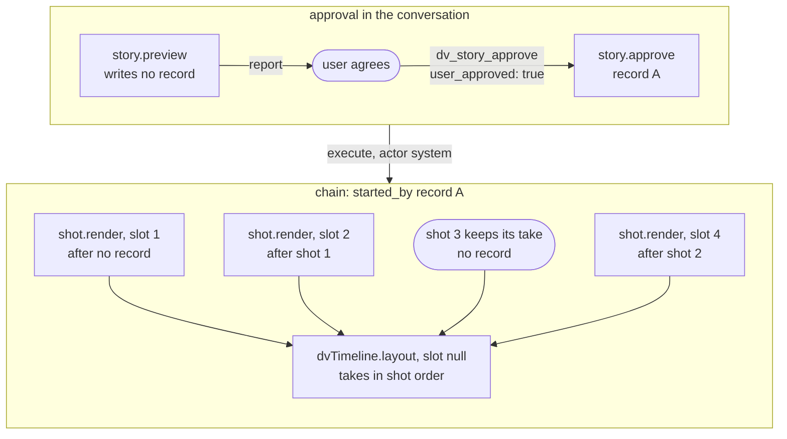

# Workflows

English | [中文](workflows.zh.md)

A workflow turns a plan version into renders and a timeline. The story workflow is the service `dvStory` of [`@dv/workflow-story`](../../../packages/dv/workflow-story/README.md) and its browser half [`@dv/ui-workflow-story`](../../../packages/dv/ui-workflow-story/README.md). The library [`@dv/workflow-kit`](../../../packages/dv/workflow-kit/README.md) holds the shot walk that every workflow calls. A workflow uses the services `dvProject`, `dvShotPlan`, `dvShotRender` and `dvTimeline`. The agent calls the workflow through its tools, and the canvas and the plan editor of `@dv/ui-shot-plan` read its approvals through its chain anchor. The [workflows Agent Note](../../../.agents/notes/implemented/architecture/2026-10-17-dv-architecture-workflows.md) holds the reasons for this design. To add a workflow, follow [Adding a workflow](../cookbook/adding-a-workflow.md).

## The workflow contract

A workflow is an ordinary component in its own package `@dv/workflow-<key>`, with the component key `<key>`. Each workflow package has these parts:

- **Preview.** `<key>.preview` has `readOnly: true` and `confirm: 'never'`. It writes no record. It reports the preview lines, the GPU estimate, and `problems`, which lists every reason that a render would be refused.
- **Approve.** `<key>.approve` has `confirm: 'always'`, and its synchronous `confirmSummary` gives a head line and the preview lines. While `problems` is not empty, its `prepareToolCall` refuses an agent call, and the runner refuses every call through its `precondition`. Both refusals come before a record exists. Its execute writes the whole chain, with no step engine and no background process.
- **Chain.** Every record that the approval writes carries `started_by` with the approval record ([the approval chain](#the-approval-chain)).
- **Services.** The workflow runs no operation by name. Renders go through the generation service `dvShotRender`, and layouts go through `dvTimeline.layout`.
- **Skill.** The skill `<key>-directing` lives in the package and registers inside `ctx.inject(['skills'], …)`. No other skill names this skill or its `dv_<key>_*` tools.
- **UI half.** `@dv/ui-workflow-<key>` registers one chain anchor in `dvCanvas.chainAnchors` and one History row in `dvHistory.rows`.
- **Test.** A REAL-composition test boots a test-only `cordis.yml` through the Loader, as `packages/dv/workflow-story/tests/fixture.ts` does.

The fitness test `scripts/dv-architecture.ts` checks the imports, the operation names and the skill texts of each workflow.

## The approval chain

The chain of an approval is the set of records that the approval writes in its execute. Each record of the chain carries `started_by: {record, slot, lane?}`:

- `record` is the approval record.
- `slot` is the position of the record in the workflow's own sequence: the 1-based shot slot for a render, and `null` for the layout.
- `lane` is optional and names a parallel sequence, such as a variant of an ad.

`@dv/project` stores `started_by` and never reads it. The starter of a record is its own `started_by` record. A record without `started_by` takes the `started_by` record of its `based_on` root, so a retake on the canvas stays in the chain of its workflow. Take reuse and timeline reuse test the starter in the log with the `Owns` function of the workflow, and never read the workflow slice. So two workflows can approve the same plan. Each workflow reuses only the takes and timelines whose starter its own `Owns` accepts.

The story chain starts with `story.preview` and ends with the layout. In this example, shot 3 keeps its take:

## The shot walk

`@dv/workflow-kit` has no component, no service and no operation, and it names no workflow. Each function takes only the `GenerationApi` methods that it calls, and a workflow passes the generation service that renders its shots. Rule R2 of the fitness test limits the number of lines of the library. The Rules section of [DreamVerse architecture checks](../architecture-checks.md) gives the limit. The [package README](../../../packages/dv/workflow-kit/README.md) gives the signatures.

| Function        | Behavior                                                                                                                                                                                                         |
| --------------- | ---------------------------------------------------------------------------------------------------------------------------------------------------------------------------------------------------------------- |
| `walkShot`      | Maps one shot of `dvShotPlan.shots` to render params. Overrides, such as the aspect ratio of a variant, replace the shot's values.                                                                               |
| `planShots`     | Parses the references of each shot and picks the take that the shot reuses through `findTake`, among the records that a `where` filter accepts. A continuing shot after a shot that renders never reuses a take. |
| `checkShots`    | Collects the refusals of the shots that render. For a continuing shot after a shot that renders, it marks the role `first_frame` as chained.                                                                     |
| `shotLine`      | Writes the preview line of one shot.                                                                                                                                                                             |
| `scheduleShots` | Renders each shot that reuses no take, each after the render before it, with `started_by: {record: approve, slot, lane}`.                                                                                        |
| `chainStarter`  | Finds the starter of a record. `takeFilter` and `keepTimeline` test that starter with the workflow's `Owns`.                                                                                                     |

`walkShot`, `planShots`, `checkShots` and `shotLine` write nothing, so a preview, a refusal check and an approval read the same steps.

## The story workflow

`dvStory` injects `dvProject`, `dvShotPlan`, `dvShotRender` and `dvTimeline`. It registers the component key `story`, the `story` reducer, `story.preview` and `story.approve`. While the DSH skill registry `skills` is mounted, it also registers the skill `story-directing`. Its `Owns` function accepts a `story.approve` record whose `plan` param names the plan.

`story.preview` (tool `dv_story_preview`) reports one preview line per shot, the number of shots that render, `gpu_seconds`, and `problems`. `gpu_seconds` is the sum of `dvShotRender.estimate` over the shots that render.

`story.approve` (tool `dv_story_approve`) has `confirm: 'always'`, so an agent call needs `user_approved: true` ([confirmation in the conversation](project.md#confirmation-in-the-conversation)). The confirm text is a head line with the plan, the version and the title, then the preview lines and the GPU estimate. In its execute, `story.approve` writes its chain as the `system` actor, with the `surface`, `session` and `turn` of the approval record:

1. `scheduleShots` renders each shot that keeps no take. A shot keeps no take when it is added or changed, or when it continues a shot that renders.
2. One `dvTimeline.layout` call lays the take of every shot on a timeline, in shot order. A clip whose render is not done is a placeholder until the render finishes.

The plan's timeline is the timeline of the plan's newest approval in the `story` slice. The layout updates that timeline only while `keepTimeline` finds a story approval of the plan as the starter of `dvTimeline.lastWrite` for it. After another write, such as an edit by the user, the layout creates the next free timeline and leaves the edited timeline unchanged.

The `story` reducer folds each `done` `story.approve` record into `approvals` (per plan, oldest first) and `timelines` (per plan, the timeline of the newest approval). The skill `story-directing` holds the flow: preview the plan, ask the user in bold, and approve in the next turn. `@dv/ui-workflow-story` anchors the records of an approval on the canvas node `plan:<PlanId>` and returns the approved versions of a plan. The plan editor of `@dv/ui-shot-plan` reads these versions through the registered chain anchors and imports no workflow package.
