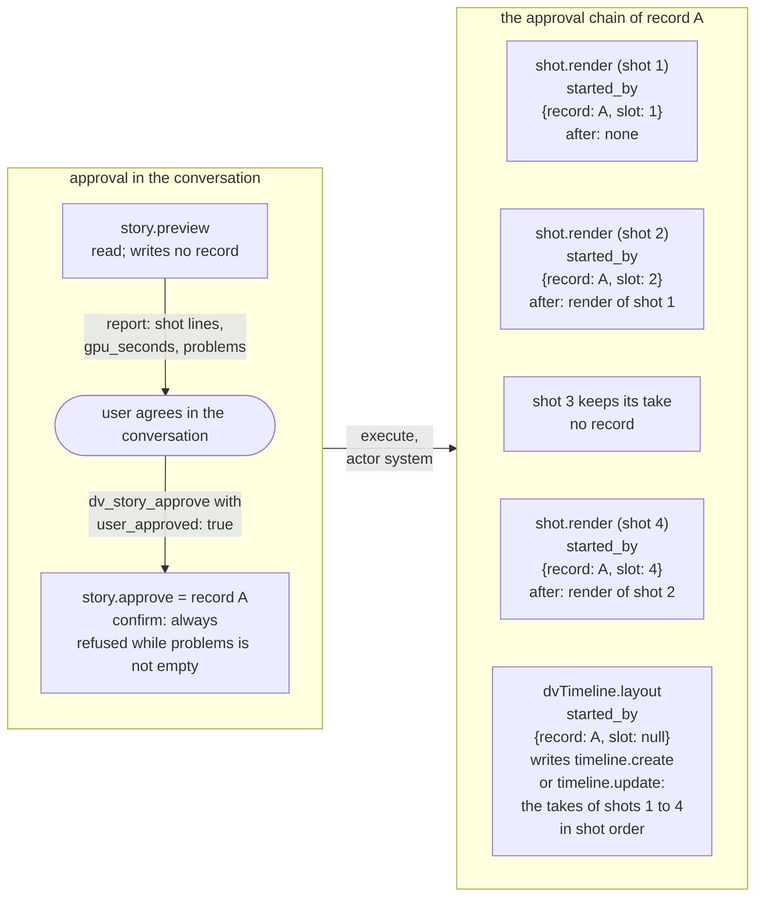

# 工作流

[English](workflows.md) | 中文

工作流把分镜计划的一个版次变成渲染和一条时间线。故事工作流是 [`@dv/workflow-story`](../../../packages/dv/workflow-story/README.zh.md) 的服务 `dvStory` 及其浏览器半部 [`@dv/ui-workflow-story`](../../../packages/dv/ui-workflow-story/README.zh.md)。库 [`@dv/workflow-kit`](../../../packages/dv/workflow-kit/README.zh.md) 持有每个工作流都调用的镜头遍历。工作流使用服务 `dvProject`、`dvShotPlan`、`dvShotRender` 和 `dvTimeline`。agent（智能体）通过工作流的工具调用它，画布和 `@dv/ui-shot-plan` 的计划编辑器通过它的链锚点读取它的审批。[工作流 Agent Note](../../../.agents/notes/implemented/architecture/2026-10-17-dv-architecture-workflows.zh.md) 记录这一设计的原因。要添加工作流，请按照[添加工作流](../cookbook/adding-a-workflow.zh.md)操作。

## 工作流约定

工作流是一个普通组件，位于自己的包 `@dv/workflow-<key>` 中，组件键为 `<key>`。每个工作流包有以下部分：

- **预览。** `<key>.preview` 为 `readOnly: true` 且 `confirm: 'never'`。它不写记录。它报告预览行、GPU 估算和 `problems`，后者列出渲染会被拒绝的每条原因。
- **审批。** `<key>.approve` 为 `confirm: 'always'`，它的同步 `confirmSummary` 给出标题行和预览行。只要 `problems` 不为空，它的 `prepareToolCall` 就拒绝 agent 调用，运行器也通过它的 `precondition` 拒绝每个调用。两种拒绝都发生在记录产生之前。它的 execute 写完整条链，不经过步骤引擎，也不经过后台进程。
- **链。** 审批写入的每条记录都带有指向审批记录的 `started_by`（[审批链](#the-approval-chain)）。
- **服务。** 工作流不按名称运行任何操作。渲染经过生成服务 `dvShotRender`，排布经过 `dvTimeline.layout`。
- **Skill。** skill（技能）`<key>-directing` 放在包内，并在 `ctx.inject(['skills'], …)` 内注册。其他 skill 都不指名这个 skill，也不指名它的 `dv_<key>_*` 工具。
- **UI 半部。** `@dv/ui-workflow-<key>` 在 `dvCanvas.chainAnchors` 中注册一个链锚点，在 `dvHistory.rows` 中注册一个 History 行。
- **测试。** 一个 REAL-composition 测试通过 Loader 启动仅供测试的 `cordis.yml`，做法同 `packages/dv/workflow-story/tests/fixture.ts`。

适应度测试 `scripts/dv-architecture.ts` 检查每个工作流的 import、操作名称和 skill 文本。

## 审批链

一次审批的链是该审批在其 execute 中写入的那组记录。链中的每条记录都带有 `started_by: {record, slot, lane?}`：

- `record` 是审批记录。
- `slot` 是该记录在工作流自身序列中的位置：渲染为从 1 开始的镜头 slot，排布为 `null`。
- `lane` 可选，指名一个并行序列，例如广告的一个变体。

`@dv/project` 存储 `started_by`，但从不读取它。一条记录的起始记录是它自己的 `started_by` 所指的记录。没有 `started_by` 的记录取其 `based_on` 根记录的 `started_by` 所指的记录，所以画布上的重拍仍留在其工作流的链中。版本（take）复用和时间线复用都用工作流的 `Owns` 函数检查日志中的起始记录，从不读取工作流切片。因此两个工作流可以审批同一个计划。每个工作流只复用起始记录被自己的 `Owns` 接受的版本和时间线。

故事链从 `story.preview` 开始，到排布结束。在这个例子中，镜头 3 保留它的版本：

## 镜头遍历

`@dv/workflow-kit` 没有组件、没有服务，也没有操作，并且不指名任何工作流。每个函数只接收它调用的那些 `GenerationApi` 方法，工作流传入渲染其镜头的生成服务。适应度测试的规则 R2 限制该库的行数。[DreamVerse 架构检查](../architecture-checks.zh.md)的规则一节给出这个上限。[包 README](../../../packages/dv/workflow-kit/README.zh.md) 给出各函数的签名。

| 函数            | 行为                                                                                                                                    |
| --------------- | --------------------------------------------------------------------------------------------------------------------------------------- |
| `walkShot`      | 把 `dvShotPlan.shots` 的一个镜头映射为渲染参数。覆盖值（例如某个变体的画幅）替换镜头自己的值。                                          |
| `planShots`     | 解析每个镜头的参考，并通过 `findTake` 在 `where` 过滤器接受的记录中选出该镜头复用的版本。接在需要渲染的镜头之后的接续镜头从不复用版本。 |
| `checkShots`    | 收集需要渲染的镜头的拒绝原因。对于接在需要渲染的镜头之后的接续镜头，它把角色 `first_frame` 标为由链提供。                               |
| `shotLine`      | 写出一个镜头的预览行。                                                                                                                  |
| `scheduleShots` | 为每个不复用版本的镜头发起渲染，每次排在前一次渲染之后，并带 `started_by: {record: approve, slot, lane}`。                              |
| `chainStarter`  | 找出一条记录的起始记录。`takeFilter` 和 `keepTimeline` 用工作流的 `Owns` 检查这条起始记录。                                             |

`walkShot`、`planShots`、`checkShots` 和 `shotLine` 不写任何东西，所以预览、拒绝检查和审批读到相同的步骤。

## 故事工作流

`dvStory` 注入 `dvProject`、`dvShotPlan`、`dvShotRender` 和 `dvTimeline`。它注册组件键 `story`、`story` reducer、`story.preview` 和 `story.approve`。DSH skill 注册表 `skills` 已挂载时，它还注册 skill `story-directing`。它的 `Owns` 函数接受 `plan` 参数指名该计划的 `story.approve` 记录。

`story.preview`（工具 `dv_story_preview`）报告每个镜头的一条预览行、需要渲染的镜头数、`gpu_seconds` 和 `problems`。`gpu_seconds` 是需要渲染的镜头的 `dvShotRender.estimate` 之和。

`story.approve`（工具 `dv_story_approve`）为 `confirm: 'always'`，所以 agent 调用需要 `user_approved: true`（[在对话中确认](project.zh.md#confirmation-in-the-conversation)）。确认文本是一个带计划、版次和标题的标题行，接着是预览行和 GPU 估算。`story.approve` 在其 execute 中以 `system` 行为者写入它的链，使用审批记录的 `surface`、`session` 和 `turn`：

1. `scheduleShots` 为每个不保留版本的镜头发起渲染。新增或改动的镜头不保留版本，接续一个需要渲染的镜头的镜头也不保留版本。
2. 一次 `dvTimeline.layout` 调用按镜头顺序把每个镜头的版本排布到一条时间线上。渲染尚未完成的片段是占位片段，直到渲染完成。

计划的时间线是 `story` 切片中该计划最新一次审批的时间线。只有当 `keepTimeline` 发现该时间线的 `dvTimeline.lastWrite` 的起始记录是该计划的一次故事审批时，排布才更新这条时间线。若之后有其他写入，例如用户的编辑，排布会创建下一个空闲时间线，并保持被编辑的时间线不变。

`story` reducer 把每条 `done` 的 `story.approve` 记录折叠进 `approvals`（按计划，最早的在前）和 `timelines`（按计划，最新一次审批的时间线）。skill `story-directing` 承载流程：预览计划，用粗体询问用户，在下一轮审批。`@dv/ui-workflow-story` 把一次审批的记录挂在画布节点 `plan:<PlanId>` 上，并返回计划已审批的版次。`@dv/ui-shot-plan` 的计划编辑器通过已注册的链锚点读取这些版次，不 import 任何工作流包。
